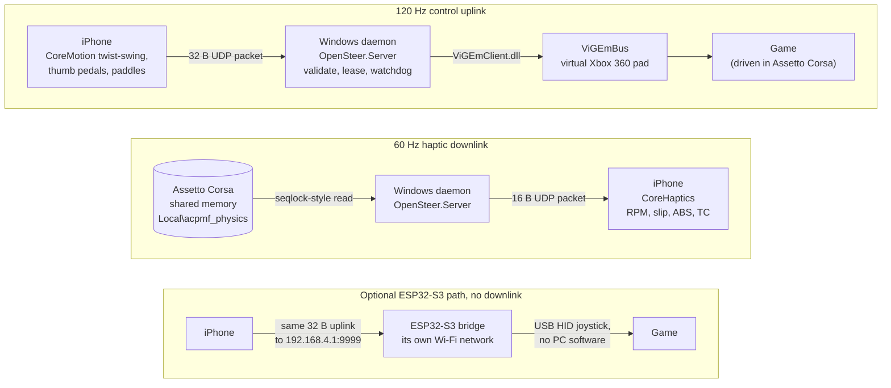

# SteeringControl (OpenSteer): Use Your iPhone as a PC Steering Wheel

[](https://github.com/DEZ-byte/SteeringControl/actions/workflows/ci.yml)
[](LICENSE)

> 💡 **New here?** Read on below for the plain-English overview, visual diagrams, and quickstart.
>
> ⚙️ Skip to **[docs/ARCHITECTURE.md](docs/ARCHITECTURE.md)** for the byte-level wire protocol, quaternion twist-swing derivations, lock-free seqlock memory ordering, and latency histograms.

Turn an iPhone into a free, low-latency 120 Hz steering wheel for PC sim racing. The PC sees a virtual Xbox 360 controller, and Assetto Corsa's telemetry comes back to the phone as haptic feedback. Setup guides cover Assetto Corsa, BeamNG.drive and Forza Horizon 4 and 5.

<!--Uncomment once recorded:  -->

---

## Why I Built This

This started as a fun project after I got frustrated driving on a keyboard and mouse in Assetto Corsa—personally, it felt awful. *(Side note: if you can't run this project and only have a mouse, what worked best for me was Assetto Corsa's mouse steering with medium-to-low in-game steering sensitivity and a high mouse DPI, which gives a proper lock-to-lock wheel rotation feel.)*

When I looked for ways to use my iPhone as a steering wheel instead, I couldn't easily find a good solution. Most of the decent free tools only supported Android, and the iPhone apps I found were either locked behind paywalls or packed with ads. Even worse, the phone-wheel apps I tried had two fundamental technical problems:
1. **Tilt-drift:** They behaved like a naive gravity projection (`atan2(gravity.y, gravity.x)`). That is only right while the phone turns in one plane: the moment the phone tilts sideways as you turn, the steering angle reads short, and shifting in your seat steers the car on its own.
2. **Wi-Fi burst lag:** A receiver that processes queued packets one by one replays old motion frames after every Wi-Fi micro-stutter, instead of jumping to where your hands actually are.

So I decided to build my own from scratch to fix all of that.

---

## How It Works

OpenSteer splits the work into two streams. A **120 Hz control uplink** carries your steering and pedals from the phone to the PC. A **60 Hz haptic downlink** carries the car's engine speed, tire slip, ABS and traction control back to the phone, which you feel as vibration.



The same system by component:

```text
  ┌─────────────────────────────────────────────────────────────────────────┐
  │                        iPhone Client (client-ios)                       │
  │  • CMMotionManager @ 120 Hz (.xArbitraryZVertical)                      │
  │  • Quaternion twist-swing decomposition around screen normal (Z)        │
  │  • Floating-anchor thumb pedals + tap shift paddles                     │
  │  • CoreHaptics driven by the 60 Hz downlink (RPM, slip, ABS, TC)        │
  └───────────────────┬─────────────────────────────────────▲───────────────┘
                      │ 32-byte UDP Uplink (120 Hz)         │ 16-byte UDP Downlink (60 Hz)
                      │ Magic 0x4F535452 + XXH32            │ Magic 0x46464231, no checksum
                      ▼                                     │
  ┌─────────────────────────────────────────────────────────┴───────────────┐
  │                  Windows Host Daemon (OpenSteer.Server)                 │
  │  • T1 Hot Loop: blocking socket poll + 64-packet non-blocking drain     │
  │  • Zero heap allocations on hot path (Span<byte>, pre-sized buffers)    │
  │  • Watchdog: 100 ms pedal decay -> 250 ms coasting fail-safe            │
  │  • T2 Telemetry: lock-free seqlock reader on Assetto Corsa shared mem   │
  └───────────────────┬─────────────────────────────────────▲───────────────┘
                      │ P/Invoke (ViGEmClient.dll)          │ Local\acpmf_physics
                      ▼                                     │
  ┌─────────────────────────────────────────────────────────┴───────────────┐
  │               Windows Kernel (ViGEmBus) & Sim Racing Title              │
  │  • Appears as an Xbox 360 controller (driven in Assetto Corsa)          │
  └─────────────────────────────────────────────────────────────────────────┘

  Optional Driverless Path (bridge-esp32, no downlink, no telemetry haptics):
  [iPhone 120 Hz UDP] ──► [ESP32-S3 Wi-Fi SoftAP (192.168.4.1:9999)] ──► [PC USB-HID Joystick]
```

> **Optional ESP32-S3 bridge:** the phone joins the bridge's own Wi-Fi network and sends the same 32-byte uplink to `192.168.4.1:9999`. The bridge shows up on the PC as a plain USB HID joystick, so the PC needs no driver and no software. The bridge has no telemetry, so that path has no downlink: no engine rumble and no ABS or TC ticks. The haptics that come from your own inputs, the shift click and the brake lockup thud, still play.

Target end-to-end LAN latency is **under 3 ms**. That is a design budget, not yet measured with a phone. With the daemon started with `--echo-rtt` and `--mode none` (no controller output), a Python mock phone on the same Windows PC measured an uplink-to-downlink loopback round trip of **173 µs** median and **517 µs** p99. Full architecture details, quaternion derivations, and benchmark tables are in **[docs/ARCHITECTURE.md](docs/ARCHITECTURE.md)**.

---

## Quickstart

You need a Windows PC and an iPhone on the same Wi-Fi network. You do not need a Mac or a compiler: every CI run builds both halves and keeps them as downloads.

1. **Install the driver.** Install [ViGEmBus v1.22.0](https://github.com/nefarius/ViGEmBus/releases) on the PC. It provides the virtual Xbox 360 controller.
2. **Get the daemon.** Open the [latest successful CI run on `main`](https://github.com/DEZ-byte/SteeringControl/actions/workflows/ci.yml?query=branch%3Amain+event%3Apush+is%3Asuccess), sign in to GitHub, and download **`OpenSteer-Server-win-x64`** from the run's **Artifacts**. Unzip it and keep `ViGEmClient.dll` in the same folder as `OpenSteer.Server.exe`. The executable is self-contained, so you do not need to install .NET.
3. **Start the daemon.** Allow UDP port 9999 through the firewall on your private network (the command is under [Security Model](#security-model)). Then start the daemon with your phone's address, which is under **Settings > Wi-Fi** on the iPhone, behind the info button next to your network:
   ```powershell
   .\OpenSteer.Server.exe --allow <phone-ip>
   ```
4. **Install the app.** Download **`OpenSteer-unsigned.ipa`** from the same run and sideload it from Windows with your own Apple ID: **[Installing on an iPhone Without a Mac](client-ios/README.md#installing-on-an-iphone-without-a-mac-sideloading-ipa-on-windows)**.
5. **Drive.** Open the app, type the PC's address, tap **Drive** and allow local network access. Hold the phone like a wheel, press **CENTER**, and set up your game: [Assetto Corsa](docs/sim-presets/assetto-corsa.md), [BeamNG.drive](docs/sim-presets/beamng-drive.md) or [Forza Horizon 4 and 5](docs/sim-presets/forza-horizon.md).

Neither download is code-signed. Windows SmartScreen can warn before the daemon's first start, and the `.ipa` installs only after the sideloading tool signs it. CI builds and checks the `.ipa`, but I have not yet installed it on a physical iPhone. GitHub deletes the artifacts after 90 days.

---

## Status

Every component builds and passes its automated test suite in CI across Windows, macOS (iOS Simulator), and Ubuntu (ESP32-S3 PlatformIO + C++ host tests).

| Component | Status |
|---|---|
| **`OpenSteer.Core`** — wire codecs, XXH32, validator, watchdog, axis math, lease & `--allow` logic | Working (`79` xUnit tests passing) |
| **`tools/`** — Python reference codecs, twist math, golden vector generator, mock phone, probes | Working (`41` unittest tests passing) |
| **`OpenSteer.Server`** — UDP hot loop, Win32 high-res timers, ViGEm output | Verified on Windows with Assetto Corsa and loopback harness; CI publishes it as the `OpenSteer-Server-win-x64` artifact |
| **Telemetry & 60 Hz FFB Downlink** — lock-free shared-memory reader (`AcSharedMemoryReader`) | Verified against a mock physics page; Assetto Corsa's live physics page confirmed with `tools/ac_shm_peek.py`; not yet received by a phone |
| **`client-ios`** — SwiftUI app & `OpenSteerCore` Swift package | Builds and passes XCTest suite in CI (macOS / iOS Simulator); CI also builds the unsigned arm64 `OpenSteer-unsigned.ipa` artifact; not yet run on a physical iPhone |
| **`bridge-esp32`** — optional ESP32-S3 Wi-Fi SoftAP to USB-HID bridge | Builds in CI (`dev` & `release` environments) and passes C++ host tests; not yet flashed to a board |
| **`third_party/vigem/ViGEmClient.dll`** — native x64 ViGEm client | Committed and SHA-256 verified at build time (`VerifyViGEmClientHash`) |

---

## Core Design Rules

Four rules shape the code. Rules 1 and 4 are pinned by regression tests; rules 2 and 3 were checked by measuring the running daemon.

### 1. Steering is a twist, not a gravity projection

**In plain English:** the obvious way to build a phone wheel is to read the angle from which way gravity pulls across the screen, like a marble rolling on a plate. Tip the plate sideways while you turn and the marble rolls the wrong amount, so the steering reads short or moves on its own. OpenSteer works like a screwdriver instead: it counts only how far you twist the handle around the screen's own axis (the screen normal, `Z`), so leaning the phone sideways does not steer.

| Marble on a plate (gravity projection) | Screwdriver (twist-swing) |
|---|---|
| Reads `atan2(gravity.y, gravity.x)` | Reads the rotation about the screen normal |
| A sideways swing changes the reading | A sideways swing adds nothing |
| Lying flat, it cannot see a turn at all | Still reads the turn when the phone lies flat |

<details>
<summary><b>🔬 Technical details & test verification</b></summary>

- Steering is the twist of the phone about its screen normal (device `+Z`), relative to the attitude captured on the first sample and again whenever you press **CENTER**: `q_rel = conj(q_ref) ⊗ q_cur`, then `θ = 2·atan2(z, w)`.
- At an 85° recline (the phone tilted 85° up from flat, 5° short of upright, as you hold a wheel), a 10° turn made together with a 20° sideways swing reads **`10.000°`** as a twist and **`7.706°`** as a gravity projection (test vector TV3).
- A 10° sideways swing with no turn reads `0` as a twist, but the gravity projection invents **`0.870°`** of steering (TV3b). Lying flat, a 30° turn reads `0°` as a gravity projection.
- A swing about one axis in the screen plane adds exactly zero. Two swings in a row about different axes add a real rotation about the screen normal, and that part does steer.
- `.xArbitraryZVertical` uses no magnetometer, so CoreMotion's yaw can drift. Upright, the twist axis is nearly horizontal and gravity corrects it. With the phone flat, the twist is the yaw, so the drift shows up as steering; pressing **CENTER** re-zeroes it.
- **Verified by** the twist vectors TV0 to TV3b and TV6 in `tools/golden_vectors.json`, checked by the Swift suite (`TwistTests`: `testTwistVectors`, `testNaiveProjectionDisagreesWhereItMatters`, `testTiltOnlyProducesNoSteering`) and the Python suite (`test_osproto.py`: `test_golden_twist_vectors`, plus `test_banned_planar_projection_is_measurably_wrong` and `test_banned_method_goes_completely_blind_when_flat`, which restate the TV3, TV3b and flat-phone numbers). The same file holds TV4 (`unwrap`), TV5 (`steer_map`) and TV8 (`steer_i16_from_norm`). Swift checks all three (`AngleUnwrapperTests.testUnwrapVector`, `SteerMapperTests.testSteerMapVectors`, `SteerMapperTests.testInt16FromNormalized`); Python checks TV4 and TV5 (`test_unwrap_reaches_beyond_half_a_turn`, `test_steer_map_and_shaping`). TV7, a hundred random attitudes, is generated inside `TwistTests.testIdenticalAttitudesGiveExactlyZero`. Derivation: [docs/ARCHITECTURE.md § 3](docs/ARCHITECTURE.md#3-steering-and-pedal-math).

</details>

### 2. A Wi-Fi burst jumps to now; it does not replay

**In plain English:** Wi-Fi often holds packets back for a moment, then delivers several at once. A receiver that works through the queue one packet at a time is like a fast-forward replay: after every stutter the wheel races through positions your hands have already left. OpenSteer works like live TV instead: it skips straight to the newest packet. While no packet arrives, the receive thread sleeps inside the operating system and uses no CPU.

| Fast-forward replay (one packet at a time) | Live TV (keep the newest) |
|---|---|
| Every queued packet moves the wheel in turn | Only the newest valid packet moves the wheel |
| After a stutter the wheel replays where your hands were | The wheel jumps to where your hands are now, skipping the stale packets |
| Each stale packet costs its own controller update | At most one controller update per wake-up, however many packets are queued |

<details>
<summary><b>🔬 Technical details & test verification</b></summary>

- The receive thread blocks in `Socket.Poll`. With no packets it wakes every 5 ms while a link is live, so the watchdog can run, and every 250 ms when idle, so an idle daemon uses effectively no CPU. When a packet arrives, it drains the queue with zero-timeout polls, at most **64 datagrams per pass**. It validates each one and keeps only the newest accepted frame. Earlier frames in the same pass that were also accepted are counted as `coalesced`.
- Every frame still updates the accept and reject counters. The inter-arrival and jitter histograms are recorded once per pass, from the newest frame, so the `coalesced` counter is what shows the bunching.
- **Verified by measurement**, not by a unit test: idle CPU `0.0 ms` across 10 s; a burst test of 12 frames back to back once a second coalesced on every burst with zero loss (24 frames coalesced across 5 bursts). Details: [docs/ARCHITECTURE.md § 5](docs/ARCHITECTURE.md#5-windows-daemon) and [§ 8](docs/ARCHITECTURE.md#8-measured-performance).

</details>

### 3. Zero allocations on the hot path

**In plain English:** a .NET program that keeps creating new objects must stop now and then to clean them up. That pause is called garbage collection, and in the middle of a corner it is a stutter. The receive loop creates everything it needs once at startup and reuses it, so a packet creates no garbage. Only the once-a-second work off the hot thread does (the stats line, and the telemetry thread's check for the game's shared memory), and in a 150-second soak the runtime never had to collect: the daemon's `gc0` counter stayed at `0`.

| New memory for every packet | Allocate once, reuse forever |
|---|---|
| Garbage piles up at 120 packets a second | Nothing new is created per packet |
| The runtime pauses the thread to collect it | No per-packet garbage; 0 collections measured |

<details>
<summary><b>🔬 Technical details & test verification</b></summary>

- The receive buffer, the receive thread's two `SocketAddress` objects (plus one on the telemetry thread) and the log ring's 2048 slots are allocated once at startup. Packets are validated in place in a `Span<byte>`. Each accepted packet is decoded with one 32-byte copy onto the stack, and the newest in a pass overwrites the earlier ones.
- The hot thread never formats a string. It pushes fixed-size events into a single-producer, single-consumer ring, and the 1 Hz stats thread formats them.
- **Verified by measurement** with the daemon's `gc0` counter: **`0` Gen-0 collections** in the mock-phone runs and over a 150-second, **18,001-frame** soak with the real ViGEm driver (zero dropped, zero malformed, zero socket errors).

</details>

### 4. Losing the link lifts your foot; it never slams the brakes

**In plain English:** if your inputs suddenly vanish mid-corner, the game can recover from a car that rolls off the throttle, but a sudden full brake can upset its tire model and spin the car. So when the phone goes quiet, OpenSteer lifts your foot instead of slamming the brakes. After 100 ms it eases off the pedals, at 250 ms it centers the wheel and coasts, and when the phone comes back it blends back in: steering over 300 ms, pedals over 100 ms.

| Slamming the brakes | Lifting your foot (OpenSteer) |
|---|---|
| Full brake the instant the link drops | Pedals fade out, then everything goes to zero, brake included |
| The car can spin mid-corner | The car coasts with the wheel centered |
| A short hiccup is a jolt | A short hiccup near the held angle snaps straight back |

<details>
<summary><b>🔬 Technical details & test verification</b></summary>

| Time since the last packet | What the watchdog does |
|---|---|
| Up to 100 ms | **Live:** the last packet stays on the controller |
| Over 100 ms | **Decaying:** steering and clutch held, buttons released; throttle and brake decay as `v0·exp(−(s − 100 ms)/30 ms)`, so **`τ = 30 ms`**, and are forced to 0 below 257 |
| 250 ms | **FailSafe:** steer 0, throttle 0, brake 0, clutch 0, buttons 0; the lease is released and the downlink stops |
| Packets return | **Recovering:** steering slews over **`300 ms`** and the pedals over **`100 ms`**; buttons follow at once. A hiccup that returns within ±4096 steer units of the held angle goes straight back to Live |

- Measured: the soft timeout fired at 102.8 ms, fail-safe at 250.2 ms with the brake still at 0, and the recovery slew completed in 300.06 ms.
- The same state machine runs in the C# daemon and the ESP32 bridge firmware. The bridge also drops straight to FailSafe when Wi-Fi reports the phone gone, and it has no lease or downlink to stop.
- **Verified by** the C# `WatchdogTests` (for example `FailSafeCoastsAndDoesNotBrake`, `DecayCurveMatchesTheGoldenVectors`, `SteerSlewMatchesTheGoldenVectors`, `ShortHiccupSnapsBackInsteadOfSlewing`) and the bridge's C++ host test (`testFailsafeCoasts`, `testDecayCurve`, `testDualSlew`), both pinned to the golden vectors. A Python copy of the bridge's arithmetic (`test_bridge_logic.py`) is checked against the same values. State diagram: [docs/ARCHITECTURE.md § 4](docs/ARCHITECTURE.md#4-watchdog-and-fail-safe).

</details>

---

## Wire Protocol at a Glance

* **Uplink, phone → PC:** 32 bytes at 120 Hz: magic `0x4F535452`, sequence, steering, three pedals, a 16-bit zero padding field, buttons, timestamp, and an XXH32 checksum seeded with `0x4F535401`.
* **Downlink, PC → phone:** 16 bytes at 60 Hz: magic `0x46464231`, RPM, ABS, TC, tire slip, and a 32-bit reserved field. No checksum and no sequence number: a lost frame is simply replaced by the next one.
* **Validation:** the PC checks length, magic, checksum and zeroed padding, in that order, then the sender's address (with `--allow`), the lease and the sequence number. The phone checks the downlink's length and magic and cleans up the slip value.
* **Encoding:** every field is little-endian and packed. Byte offsets, packet diagrams and the checksum's known-answer tests are in **[docs/ARCHITECTURE.md § 2](docs/ARCHITECTURE.md#2-wire-protocol)**.

---

## Repository Layout

```text
server-windows/
  OpenSteer.Core/          portable protocol, math, and watchdog library (no Win32, no sockets, no Console)
  OpenSteer.Server/        Windows daemon: UDP hot loop, P/Invoke, ViGEm sink, shared-memory telemetry
  OpenSteer.Tests/         xUnit test suite (references OpenSteer.Core only)
tools/                     Python reference implementation, desktop feeders, probes, and golden vector generator
client-ios/
  Sources/OpenSteerCore/   quaternion twist math, wire codecs, pedal mapper, haptics policy (Foundation only)
  Tests/                   XCTest suite pinned to the shared golden vector fixture
  App/                     XcodeGen project spec and SwiftUI application
bridge-esp32/              ESP32-S3 Wi-Fi SoftAP to USB-HID joystick firmware (optional hardware bridge)
docs/
  ARCHITECTURE.md          full wire specification, state machines, threading model, and latency numbers
  hardware/                experimental DIY cardboard wheel guide and layout template
  sim-presets/             per-game setup guides (Assetto Corsa, BeamNG.drive, Forza Horizon) and an Assetto Corsa controller preset
third_party/vigem/         ViGEmClient.dll, committed and hash-verified at build time
```

`OpenSteer.Tests` references `OpenSteer.Core` and never the server executable. That keeps the test project free of the executable's entry point and allows `OpenSteer.Server` to publish cleanly as a self-contained single-file binary.

---

## Building & Running

### Prerequisites
* **Windows Daemon:** .NET 8 SDK and the [ViGEmBus v1.22.0](https://github.com/nefarius/ViGEmBus/releases) driver (provides the virtual Xbox 360 controller).
* **Python Harness & Tools:** Python 3.13+ (uses standard library only—no `pip install` needed for tests).
* **iOS Client:** macOS with Xcode 15+ and XcodeGen to build from source (see **[client-ios/README.md](client-ios/README.md)**), or only a Windows PC to sideload the CI-built `.ipa` (see **[Installing on an iPhone Without a Mac](client-ios/README.md#installing-on-an-iphone-without-a-mac-sideloading-ipa-on-windows)**).
* **ESP32-S3 Bridge:** PlatformIO or Arduino CLI (see **[bridge-esp32/README.md](bridge-esp32/README.md)**).

### Running the Test Suites

From the repository root:

```bash
# Run the 79 C# xUnit tests
dotnet test server-windows/OpenSteer.Tests/OpenSteer.Tests.csproj

# Run the 41 Python unittest tests (protocol, bridge logic, and live daemon probes).
# The 3 daemon probes need Windows and a Release build: they are skipped if the daemon
# has not been built (and the stale-telemetry probe while Assetto Corsa is running),
# and fail if the build is older than its sources, so rebuild first.
dotnet build server-windows/OpenSteer.sln -c Release
python -m unittest discover -s tools -p "test_*.py"
```

### Running the Windows Daemon

Start the daemon and restrict UDP input to your phone's IPv4 address with `--allow`:

```powershell
dotnet run --project server-windows/OpenSteer.Server -c Release -- --mode a --allow <phone-ip>
```

To build a standalone release executable:

```powershell
dotnet publish server-windows/OpenSteer.Server -c Release -r win-x64
```

The standalone executable and `ViGEmClient.dll` are written to `server-windows/OpenSteer.Server/bin/Release/net8.0-windows/win-x64/publish/`.

### Testing on Windows Without an iPhone

You can test the daemon and drive in Assetto Corsa on a Windows PC without an iPhone using the included Python tools. The tools send from `127.0.0.1`, so start the daemon with `--allow 127.0.0.1` (a phone-only `--allow` drops their packets):

```powershell
dotnet run --project server-windows/OpenSteer.Server -c Release -- --mode a --allow 127.0.0.1
```

Then, in a second terminal:

```powershell
# Drive the virtual Xbox 360 controller using your keyboard
# (A/D = steer, W/S = throttle/brake, Space = handbrake, E/Q = shift, R = re-center, Esc = stop)
python tools/drive_keys.py

# Or run the automated sine-wave mock phone feeder and inspect the controller in joy.cpl
python tools/feed_joycpl.py --duration 30
```

`drive_keys.py` reads the keyboard globally while it runs, so its keys act whatever window has focus. In Assetto Corsa, set **Input method: Gamepad** and load the `OpenSteer_Xbox360` preset first: the stock preset binds several of those keys to game shortcuts.

Setup guides for **Assetto Corsa**, **BeamNG.drive**, and **Forza Horizon 4/5**, plus a ready-made Assetto Corsa controller preset, are in **[docs/sim-presets/](docs/sim-presets/)**.

---

## Cross-Language Golden Vectors

`tools/golden_vectors.json` is the single conformance fixture behind all four implementations. It is generated deterministically by `tools/golden_vectors.py` and never edited by hand.

* Before writing the fixture, `golden_vectors.py` checks its own XXH32 implementation against four published reference values (`""`, `"a"`, `"abc"`, and `"Nobody inspects the spammish repetition"`).
* The Python suites (`test_osproto.py` and `test_bridge_logic.py`) load `tools/golden_vectors.json` directly, the C# suite (`OpenSteer.Tests`) loads the copy its build places beside the test assembly, and the Swift suite (`OpenSteerCoreTests`) loads a byte-identical copy bundled with its tests; each checks the frame bytes, checksums, steering math, or watchdog curves it implements. The C++ host test (`bridge-esp32/test/test_pure.cpp`) carries checksum, sequence-wrap, and watchdog values copied from the fixture.
* CI regenerates the fixture on every push to `main` and on every pull request, and fails if it differs from the committed file or from the Swift test bundle's copy.

```bash
python tools/golden_vectors.py
```

---

## Security Model

The UDP protocol uses an XXH32 checksum to catch packet corruption, not to provide cryptographic authentication. Without `--allow`, any host that can reach UDP port 9999 on the PC can claim an idle session and drive the virtual controller.

* **Filter by source IP:** Pass `--allow <phone-ip>` on any network you do not fully control so packets from any other address are dropped before they can take the session. This is a source filter, not authentication: a host on the same network can still forge the phone's address.
* **Scope the Windows Firewall rule:** Allow UDP 9999 inbound on the **Private** network profile and local subnet only—never on `Public`:
  ```powershell
  New-NetFirewallRule -DisplayName 'OpenSteer UDP 9999' -Direction Inbound -Protocol UDP -LocalPort 9999 -RemoteAddress LocalSubnet -Action Allow -Profile Private
  ```
* **ESP32-S3 SoftAP passphrase:** No default Wi-Fi password ships in the repository. Copy `bridge-esp32/src/ap_secret.example.h` to `bridge-esp32/src/ap_secret.h` (git-ignored) and set your own WPA2 passphrase before building the firmware.

See **[SECURITY.md](SECURITY.md)** for full details and private vulnerability reporting instructions.

---

## DIY Cardboard Rig & Contributing

A bare phone works as a wheel, but a rim gives your hands something to hold, and cardboard levers can work the on-screen pedals and paddles for you. **[docs/hardware/CARDBOARD_WHEEL.md](docs/hardware/CARDBOARD_WHEEL.md)** describes a fold-together cardboard wheel for an iPhone. Copper tape carries the touch of your fingers from the levers to the screen, so it needs no electronics and no app changes. **[docs/hardware/cardboard-wheel-template.svg](docs/hardware/cardboard-wheel-template.svg)** shows where each part goes.

It is an experimental concept: I have not built it yet. Help is welcome:

* **Build the rig** and report what worked and what did not, with photos.
* **Contribute templates:** cardboard cut sheets, laser-cut files, or 3D-printable STL parts.
* **Test sideloading** the CI-built `.ipa` on a real iPhone, and report the iOS version and the tool you used.

Report results and bugs in [GitHub Issues](https://github.com/DEZ-byte/SteeringControl/issues), or open a pull request.

---

## Third-Party Components & License

`third_party/vigem/ViGEmClient.dll` (x64, FileVersion `1.21.233.0`, 141,312 bytes, MIT-licensed) is extracted unmodified from the `costura64.vigemclient.dll` resource of the official `Nefarius.ViGEm.Client` `1.21.256` NuGet package and committed so the server build needs no separate download of the ViGEm client.

* The MSBuild target `VerifyViGEmClientHash` verifies the DLL's SHA-256 digest on every build and publish.
* The P/Invoke resolver loads `ViGEmClient.dll` only from the executable's own directory (`AppContext.BaseDirectory`) and fails closed if it is missing; every other native import is limited to `SafeDirectories`, so nothing is searched for on `PATH` or in the working directory.

The prebuilt `OpenSteer-Server-win-x64` download from CI also bundles the MIT-licensed .NET 8 runtime inside the executable, and carries `LICENSE` and `THIRD_PARTY_NOTICES.md` beside it.

Full provenance, the pinned SHA-256 digest, and upstream license texts are in **[THIRD_PARTY_NOTICES.md](THIRD_PARTY_NOTICES.md)**. This project is licensed under the **[MIT License](LICENSE)**.
