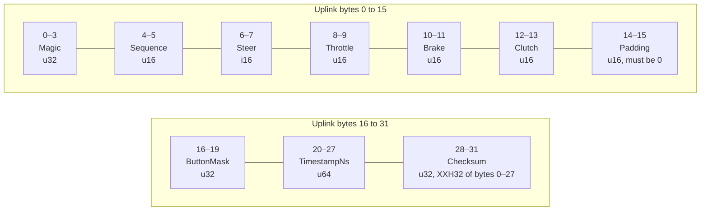
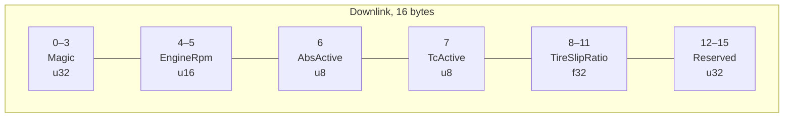
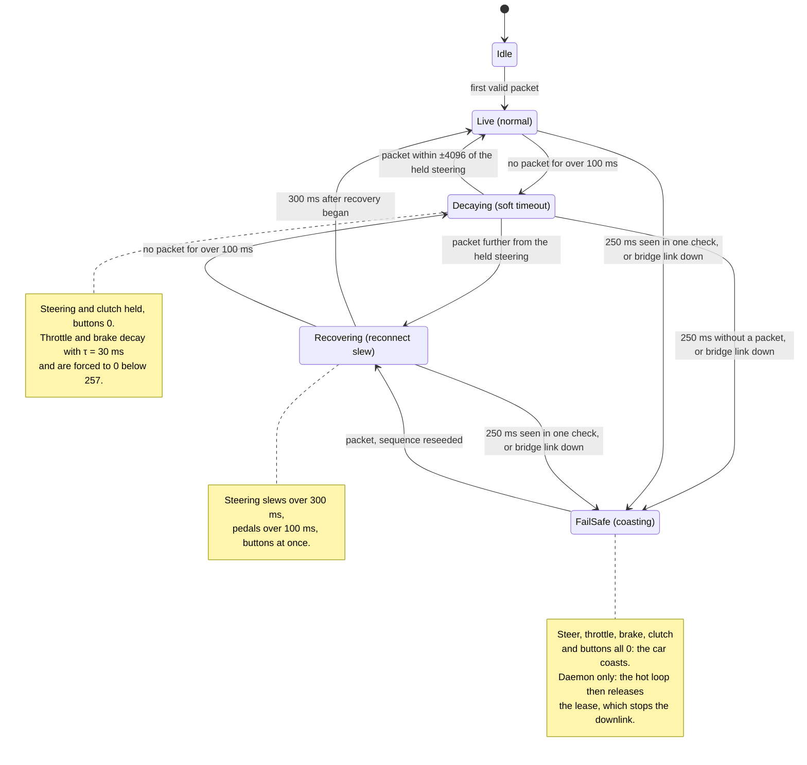
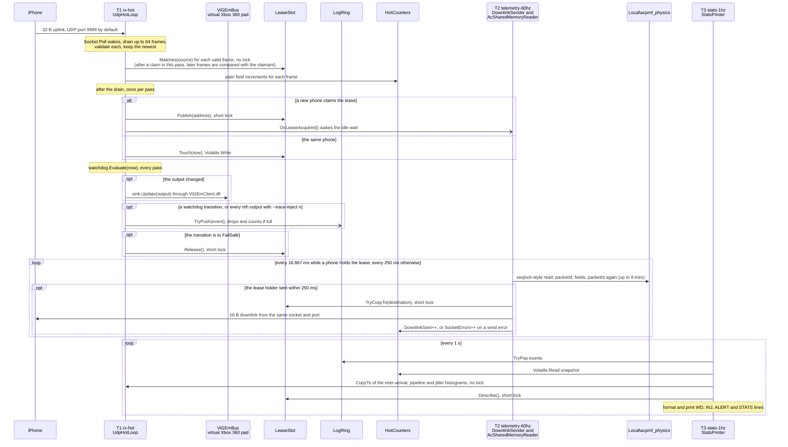

# Architecture

[⬅️ Back to Main README](../README.md)

This document describes how SteeringControl (OpenSteer) works: the data path, the
wire protocol, the steering math, the safety watchdog, the Windows daemon's threads,
and the measurements behind the performance claims. The build and run instructions
for each part are in its own README.

## 1. Overview

An iPhone acts as a steering wheel. It reads its own rotation at 100 Hz, turns the
twist of the phone into a steering value, adds two thumb pedals and two shift paddles,
and sends a 32-byte UDP packet per sample. A Windows daemon validates each packet and
feeds a virtual Xbox 360 controller through ViGEmBus, which games see as real
hardware. The daemon also reads Assetto Corsa's telemetry from shared memory and sends
a 16-byte packet back at 60 Hz, which the phone plays as haptics.

```
iPhone                                         Windows PC
------                                         ----------
CoreMotion, 100 Hz --+
touch pedals --------+--> twist, shaping --> 32 B uplink --UDP 9999--> OpenSteer.Server
paddles -------------+                                                  |  validate, lease,
                                                                        |  watchdog
                                                                        v
                                                       ViGEmBus virtual Xbox 360 pad --> game
                                                                        |
                                              Assetto Corsa shared memory (seqlock read)
                                                                        |
CoreHaptics <-- haptic policy <-- 16 B downlink <--UDP 9999 (60 Hz)-----+
```

An optional ESP32-S3 bridge replaces the daemon for the input path. The phone joins
the bridge's own Wi-Fi access point and sends the same uplink to `192.168.4.1:9999`.
The bridge presents itself to the PC as a USB HID joystick, so the PC needs no
driver and no software. The bridge has no telemetry, so there is no downlink on that
path: no engine rumble and no ABS or TC ticks. The haptics driven by the driver's own
inputs, the shift click, the brake lockup thud and the CENTER pulse, still play.

| Part | Language | Role |
|---|---|---|
| `server-windows/OpenSteer.Core` | C# (.NET 8) | wire format, checksum, validator, watchdog, axis math, lease and `--allow` decisions. No sockets, no Win32, no console |
| `server-windows/OpenSteer.Server` | C# (.NET 8, `net8.0-windows`) | the daemon: UDP hot loop, Win32 interop, ViGEm output, telemetry reader, downlink |
| `server-windows/OpenSteer.Tests` | C# (xunit) | unit tests; references Core only |
| `client-ios/Sources/OpenSteerCore` | Swift | twist math, mappers, codecs, link state machine, haptic policy. Foundation only |
| `client-ios/App` | Swift (SwiftUI) | CoreMotion, Network.framework, CoreHaptics, the user interface |
| `bridge-esp32` | C++ (Arduino core 3.3.12 on ESP-IDF 5.5.5) | optional Wi-Fi to USB HID bridge |
| `tools` | Python 3.13, standard library only | protocol reference, golden vectors, mock phone, probes, test harness |

### Verification status

| Part | State |
|---|---|
| Windows daemon and telemetry | verified on real hardware and driven in Assetto Corsa, with the keyboard tool and with a physical iPhone over Wi-Fi (section 8) |
| iOS core library and app | verified end-to-end on a physical iPhone (iOS 27.0.1) driving Assetto Corsa over Wi-Fi, with the 60 Hz downlink reaching the phone; section 8 has the PC-side figures. They build and pass their tests in CI on macOS: `swift test`, and `xcodebuild test` on an iOS simulator. CI also builds the app for a real iPhone (arm64, unsigned) and uploads it as `OpenSteer-unsigned.ipa`; the copy tested was sideloaded with a free Apple ID |
| ESP32 bridge | both firmware variants build in CI; the checksum and watchdog pass host tests under g++. Not yet flashed |

CI (`.github/workflows/ci.yml`) runs every suite on each push to `main` and on pull
requests, checks that the committed fixture matches its generator, and scans the
full history for secrets. Each run also uploads two unsigned builds as artifacts:
the self-contained daemon (`OpenSteer-Server-win-x64`) and the iPhone app
(`OpenSteer-unsigned.ipa`), which a sideloading tool signs with the user's own Apple
ID ([client-ios/README.md](../client-ios/README.md#installing-on-an-iphone-without-a-mac-sideloading-ipa-on-windows)).
Run artifacts need a GitHub sign-in and expire after 90 days. The
[latest release](https://github.com/DEZ-byte/SteeringControl/releases/latest) carries
the same two files from a run on `main` that passed every job, as
`OpenSteer-Server-win-x64.zip` and `OpenSteer-unsigned.ipa`. Release downloads need
no account and do not expire.

### The golden vectors

`tools/golden_vectors.json` is the shared conformance fixture. It is generated by
`tools/golden_vectors.py`, which first checks its XXH32 implementation against the
published reference vectors. The C# tests, the Swift tests and the bridge's host
tests all check against values from it, so all three implementations are tested
against the same independently checked numbers. Do not edit it by hand.

### Latency budget

The end-to-end target is under 3 ms from phone motion to the virtual controller.

| Stage | Budget |
|---|---|
| CoreMotion delivery | 0.2 to 0.5 ms |
| Twist, shaping, encode and checksum on the phone | under 0.05 ms |
| Network.framework send to Wi-Fi transmit | 0.3 to 1.5 ms |
| Air time | 15 to 140 µs |
| NIC interrupt to the daemon waking from `select` | 0.1 to 0.3 ms |
| Validate and decode | under 0.01 ms |
| ViGEm IOCTL | 0.1 to 0.3 ms |
| **Total** | **1 to 2.7 ms** |

One lost datagram costs 10 ms of staleness at the 100 Hz a real iPhone delivers. The
payload is 3.2 kB/s up (100 × 32 B) and 0.96 kB/s down (60 × 16 B). With Ethernet
framing (78 and 62 bytes per frame) that is about 7.8 kB/s and 3.7 kB/s, roughly
0.1 Mbit/s in total, with no fragmentation.

## 2. Wire protocol

Both packets are little-endian and packed, with no padding between fields. IPv4
only. Python uses `struct` with `'<'` and Swift writes each field at an explicit
byte offset (`storeBytes(of:toByteOffset:as:)`, `loadUnaligned`). C# uses a `Pack=1`
struct whose size is asserted at startup, and C++ uses a packed struct with
`static_assert` on both packet sizes, on the offset of every uplink field from
`sequence` to `checksum`, and (where the compiler defines `__BYTE_ORDER__`) on
little-endian byte order.

### Uplink: phone to PC, 32 bytes

Python format `'<IHhHHHHIQI'`.

| Offset | Size | Type | Field | Rule |
|---|---|---|---|---|
| 0 | 4 | uint32 | Magic | `0x4F535452`. On the wire: `52 54 53 4F` |
| 4 | 2 | uint16 | Sequence | increments per packet, wraps 65535 to 0 |
| 6 | 2 | int16 | Steer | −32767 to +32767. +32767 is full right lock. −32768 is never sent; receivers saturate it to −32767 |
| 8 | 2 | uint16 | Throttle | 0 to 65535 |
| 10 | 2 | uint16 | Brake | 0 to 65535 |
| 12 | 2 | uint16 | Clutch | 0 to 65535 (the app sends 0) |
| 14 | 2 | uint16 | Padding | sender writes 0; receiver rejects anything else |
| 16 | 4 | uint32 | ButtonMask | bit 0 upshift, bit 1 downshift, bit 2 handbrake, bits 3 to 31 spare. Level-triggered |
| 20 | 8 | uint64 | TimestampNs | sender's monotonic clock in ns. Used only for jitter statistics |
| 28 | 4 | uint32 | Checksum | XXH32 over bytes 0 to 27, seed `0x4F535401`, stored little-endian |



`TimestampNs` at offset 20 is 4-byte aligned, not 8-byte aligned. A Swift struct with
the same members is 36 bytes because Swift pads the `UInt64`, so the Swift client
never asserts `MemoryLayout<UplinkState>.size == 32`. The golden hex vectors are the
layout check.

Steering is encoded as `lround(clamp(norm, −1, 1) × 32767)`. Known answers: −1.0
encodes as `01 80`, +1.0 as `FF 7F`, 0 as `00 00`.

### Downlink: PC to phone, 16 bytes

Python format `'<IHBBfI'`.

| Offset | Size | Type | Field | Rule |
|---|---|---|---|---|
| 0 | 4 | uint32 | Magic | `0x46464231`. On the wire: `31 42 46 46` |
| 4 | 2 | uint16 | EngineRpm | Assetto Corsa `rpms`, clamped to 0 to 65535 |
| 6 | 1 | uint8 | AbsActive | 0 or 1; the phone treats any nonzero value as 1 |
| 7 | 1 | uint8 | TcActive | 0 or 1 |
| 8 | 4 | float32 | TireSlipRatio | 0.0 to 1.0. The phone maps NaN and infinity to 0 and clamps |
| 12 | 4 | uint32 | Reserved | 0. With `--echo-rtt` it carries the low 32 bits of the uplink timestamp, for round-trip measurement |



Known answer: `31 42 46 46 52 1C 01 00 00 00 00 3E 00 00 00 00` is RPM 7250, ABS 1,
TC 0, slip 0.125. The downlink has no sequence number; loss is tolerated. It is sent
at 60 Hz while a phone holds the lease, and stops when the lease is released. With
`--echo-rtt`, the 60 Hz sender stops and the hot thread instead sends one downlink
per pass that accepted an uplink (the newest of a burst), carrying that uplink's
timestamp.

### Checksum

XXH32 with seed `0x4F535401` over a fixed 28-byte input. The checksum detects
corruption. It is not authentication: the seed is public, so anyone who can reach the
port can build a valid frame. A nonzero seed means a 32-byte datagram from another
protocol cannot pass the check by coincidence. XXH32 was chosen over Fletcher-16
because Fletcher-16 uses only half of the 32-bit field, has no seed, and cannot tell
a run of `00` bytes from a run of `FF` bytes.

```
P1=0x9E3779B1 P2=0x85EBCA77 P3=0xC2B2AE3D P4=0x27D4EB2F  SEED=0x4F535401
all arithmetic mod 2^32; rotl = 32-bit rotate left
u32(b,i)    = b[i] | b[i+1]<<8 | b[i+2]<<16 | b[i+3]<<24     (byte lanes, no pointer casts)
round(a,x)  = rotl(a + x*P2, 13) * P1

xxh32_28(b):
  v1 = SEED+P1+P2; v2 = SEED+P2; v3 = SEED; v4 = SEED-P1
  v1 = round(v1,u32(b,0)); v2 = round(v2,u32(b,4)); v3 = round(v3,u32(b,8)); v4 = round(v4,u32(b,12))
  h  = rotl(v1,1) + rotl(v2,7) + rotl(v3,12) + rotl(v4,18) + 28
  for i in (16, 20, 24): h = rotl(h + u32(b,i)*P3, 17) * P4
  h ^= h>>15; h *= P2; h ^= h>>13; h *= P3; h ^= h>>16
  return h
```

Every implementation must pass these known-answer tests:

| Vector | Input | Expected |
|---|---|---|
| KAT-0 | 28 zero bytes | `0x38018272` |
| KAT-1 | `52 54 53 4F 01 00 39 30 FF FF 00 00 00 00 00 00 05 00 00 00 89 67 45 23 01 00 00 00` (seq 1, steer 12345, throttle 65535, buttons 0x5, ts 0x123456789) | `0xF4FDFD7A`, written at offset 28 as `7A FD FD F4` |
| KAT-2 | `52 54 53 4F FF FF 00 80 00 00 FF FF 00 80 00 00 07 00 00 80 FF FF FF FF FF FF FF FF` (seq 65535, steer −32768, brake 65535, clutch 32768, buttons 0x80000007, ts max) | `0xA5B68410` |

The generic XXH32 reference vectors also hold: `""` gives `0x02CC5D05` and `"abc"`
gives `0x32D153FF` with seed 0.

### Receive validation

The daemon checks each datagram in this order. The first failure drops the datagram
and increments exactly one counter.

| Step | Check | Counter on failure |
|---|---|---|
| 1 | length is exactly 32 (received into a 64 KiB buffer, so oversize never throws) | `bad_len` |
| 2 | magic is `0x4F535452` | `bad_magic` |
| 3 | checksum matches | `bad_csum` |
| 4 | padding is 0 | `bad_pad` |
| 4b | with `--allow <phone-ip>`: the source is IPv4 and equals that address | `other_src` |
| 5 | lease: the source equals the lease holder, or there is no lease yet, or the watchdog is in fail-safe (takeover) | `other_src` |
| 6 | sequence (see below) | `dup`, `stale`, `drop` |
| 7 | steer −32768 is saturated to −32767 | none |

Steps 1 to 4 and 6 live in `OpenSteer.Core.PacketValidator` as pure span logic.
Steps 4b and 5 need the sender's socket address and live in the daemon's hot loop.
Step 7 happens when the watchdog takes the packet (`AxisMath.SaturateSteer`).

Sequence numbers are compared with a signed 16-bit difference,
`d = (short)(seq − lastSeq)`, so the comparison is correct across the 65535 to 0 wrap.
`d == 0` is a duplicate, `d < 0` is stale, `d > 1` counts `d − 1` drops. The
validator reseeds (accepts the packet and restarts counting) when it has no previous
sequence, when the sender changes, when the watchdog is in fail-safe, or after more
than 100 ms of silence. A reseed is how a restarted phone or a new sender is accepted
without being rejected as stale.

The phone validates the downlink the same way: length 16, magic, NaN and infinity to
0, clamp, nonzero flags to true, reserved ignored unless round-trip display is on.

### Session, lease and addressing

There is no handshake. The first valid datagram takes the lease, and with `--allow`
only the named address can. While the lease holder is live, any other sender is
dropped and counted as `other_src`. The lease is released when the watchdog enters
fail-safe after 250 ms of silence, and the next valid sender then takes over. Using
the fail-safe as the release point avoids a second timeout constant, and the
downlink stops at the same moment.

The phone uses one connected UDP `NWConnection` with `serviceClass =
.interactiveVoice`, which marks packets DSCP EF and puts them in the Wi-Fi voice
queue (WMM AC_VO). Cellular is prohibited; a hotspot is allowed. The daemon binds an
unconnected socket to port 9999 and replies from that same socket, so the reply
comes from the port the phone sent to. That keeps the phone on one flow that NAT and
the phone's own stack already track, and it needs no inbound firewall rule on the
phone side.

There is no discovery. The phone's user types the PC's address once and the app
remembers it. On an iPhone hotspot the PC is in `172.20.10.x`; the bridge is always
`192.168.4.1`.

## 3. Steering and pedal math

### The twist angle

The steering angle is the pure twist of the phone about its screen normal (device
+Z, pointing out of the screen toward the driver), relative to a reference attitude
captured when the driver presses **CENTER**. It is extracted from the relative
attitude quaternion by twist-swing decomposition.

The obvious method, `atan2(gravity.y, gravity.x)`, is right only while the phone
turns in one plane. A pure turn at a fixed pitch reads correctly, and changing the
pitch alone adds nothing. It goes wrong when the phone also swings sideways. With the
phone pitched 85 degrees up from flat (5 degrees short of upright), a 10 degree turn
made together with a 20 degree sideways swing reads as 7.706 degrees, and a 10
degree swing with no turn at all reads as 0.870 degrees of steering. Lying flat, the
projection cannot see a turn: 30 degrees reads as zero. The twist is unaffected by swing: a pure swing gives exactly
zero, and the order of swing and twist does not change the result.

CoreMotion's attitude quaternion maps the body frame to the reference frame, so a
body rotation `q_δ` right-multiplies: `q_cur = q_ref ⊗ q_δ`, which gives
`q_rel = conj(q_ref) ⊗ q_cur = q_δ`, expressed in the calibration body frame. Only two
components of `q_rel` are needed:

```
w = wr·wc + xr·xc + yr·yc + zr·zc
z = wr·zc − xr·yc + yr·xc − zr·wc
if w·w + z·z < 1e-9: hold the previous angle      (degenerate swing)
if w < 0: w = −w; z = −z                          (canonicalize the double cover)
θ = 2·atan2(z, w)
```

The normalization of `(w, 0, 0, z)` cancels inside `atan2`. The argument order
matters: `q_cur ⊗ conj(q_ref)` gives the world-frame Z component instead, which
shrinks by about cos(pitch) and reads under a tenth of a real turn at an 85 degree
pitch.

Sign: θ is a right-hand rotation about +Z. Turning the phone clockwise, as the driver
sees it, is negative θ, so `norm = clamp(−θ / (DOR / 2), −1, 1)`.

TV0 to TV6 and TV8 are pinned in the golden vectors. TV7 is generated inside the Swift
test `testIdenticalAttitudesGiveExactlyZero`. Swift checks every row; Python checks
TV0 to TV6:

| Vector | Reference, current | Expected |
|---|---|---|
| TV0 | identity, identity | 0 |
| TV1 | identity, Rz(30°) | θ = +30°; at 360° rotation, steer −5461 |
| TV2 | Rx(60°), Rx(60°)·Rz(10°) | 10.000° |
| TV3 | Rx(85°), Rx(85°)·Rz(10°)·Ry(20°) | 10.000° (the gravity projection gives 7.706°) |
| TV3b | Rx(85°), Rx(85°)·Ry(10°) | 0 (the gravity projection gives 0.870°) |
| TV4 | Rz(5°·k), k = 0 to 80, unwrapped | 400°; at 900° rotation, −400/450 |
| TV5 | unwrapped ±200° at 360° rotation | −32767 / +32767 |
| TV6 | shaping with δ = 0.05, γ = 1.2 | f(0.05) = 0, f(1) = 1, f(−0.5) = −(0.45/0.95)^1.2 |
| TV7 | 100 random attitudes with q_ref = q_cur | 0 ± 1e-9 |
| TV8 | norm −1, 0, 0.5, +1 | −32767, 0, 16384, 32767 |

TV0 to TV5, TV7 and TV8 use no deadband and no gamma. A quaternion and its negation
give the same result.

### Unwrapping and shaping

`2·atan2` is bounded to ±180°. `AngleUnwrapper` accumulates the wrapped difference
between samples so rotations past half a turn keep counting. The reference attitude
and the unwrapper reset together on **CENTER**.

`SteerMapper` then applies, in order:

1. Degrees of rotation (DOR): how far the phone turns for full lock. The app offers
   120, 150, 180, 240 and 360 degrees. The default, 180, means full lock at 90
   degrees each way.
2. Deadband δ (default 0.01) with rescaling, so the deadband does not also cap the
   output: `y = sign(x) · max(0, (|x| − δ) / (1 − δ))`.
3. Gamma γ (default 1.15): `y = sign(y) · |y|^γ`. Values above 1 soften the center
   and keep full lock reachable.
4. `Int16(clamping: lround(y · 32767))`, never −32768.

Shaping happens once, on the phone. The daemon has no shaper. Any steering filter or
gamma left enabled in a game stacks a second curve on top of this one, which is why
the sim presets turn them off.

### Pedals and paddles

The screen is landscape. The left quarter is the brake, the right quarter is the
throttle, and the middle half holds the wheel graphic, the readouts and every button.
Each pedal zone runs the full height of the screen, with nothing cut out of it, and
tracks one touch.

A pedal reads 0 wherever the thumb lands (a floating anchor) and applies as the thumb
slides up. Screen y grows downward, so `v = clamp((anchorY − y) / travel, 0, 1)`,
with `travel` 140 points by default (80 to 260). If the thumb goes past full travel
the anchor follows it up, so the pedal stays at 100% and starts easing as soon as the
thumb comes back down. If the thumb moves below the anchor, the anchor moves down with
it, so a release is always immediate. Lifting the thumb returns the pedal to 0 at once.
Output is `UInt16((v · 65535).rounded())`.

The paddles sit at the top of the middle half, either side of the RPM bar: upshift on
the right (bit 0), downshift on the left (bit 1). A tap is held for at least 3 packets
so a short tap is never lost. The paddles live in the middle half because a pedal
applies as the thumb slides up. A thumb at full travel ends up near the top of its
zone, so a paddle in a top corner would catch the next press. The paddle row is half
the safe-area width, centered, with a 12-point margin at each end, and the zones are
measured across the whole glass, so the row never reaches into either zone. Handbrake
(bit 2) is a hold button in the row at the bottom of the middle half.

An upward slide that starts right at the bottom edge looks like the system's swipe
home. The app defers edge gestures, but on a Face ID iPhone that one cannot be
deferred: with the home indicator hidden, the first swipe only shows it and the next
one leaves the app. The pedal help text tells the driver to start a little above the
edge.

### Motion capture on iOS

`CMMotionManager` runs with `deviceMotionUpdateInterval = 1/120` and the
`.xArbitraryZVertical` reference frame, which needs no magnetometer and no
calibration motion. Updates are delivered to a dedicated serial background queue,
and the whole chain from attitude to sent packet runs there: read the quaternion,
take control inputs, twist, unwrap, shape, encode, checksum, send, publish a snapshot.
The budget is under 2 µs per sample up to the finished packet and 10 to 40 µs for
the send call. These are design budgets; they have not been measured on a phone.

The interval is a request, not a promise. When it is faster than the hardware
allows, Core Motion delivers at the hardware's maximum instead. On the iPhone tested
(iOS 27.0.1) that was 100 Hz: in every second of both drives in section 8, the
daemon's median inter-arrival was between 9.7 and 10.3 ms. A real phone therefore
sends 100 packets a second.

The sensor loop never runs on the main queue. SwiftUI shares the main queue with
layout and gesture handling, so one slow frame would delay a steering packet.
`MotionEngine`'s initializer throws `PipelineError.mainQueueForbidden` if it is given
the main queue. `CADisplayLink` is used only to draw: the wheel graphic reads the
latest snapshot and sets one layer transform per frame, at up to 120 Hz on ProMotion
(`preferredFrameRateRange` 80 to 120, plus the
`CADisableMinimumFrameDurationOnPhone` Info.plist key, without which iOS caps the app
at 60 Hz). Text readouts update at 15 Hz. Nothing at sensor or display rate goes
through an observable object.

With `.xArbitraryZVertical`, the twist axis is close to horizontal when the screen
faces the driver, so gravity corrects drift. With the phone flat, yaw drift becomes
visible and **CENTER** fixes it.

## 4. Watchdog and fail-safe

The same state machine runs in `OpenSteer.Core/Watchdog.cs` and
`bridge-esp32/src/watchdog.cpp`. It is pure: no I/O, and time is passed in.

| Constant | Value |
|---|---|
| Soft timeout | 100 ms |
| Pedal decay time constant τ | 30 ms |
| Hard timeout | 250 ms |
| Steering recovery slew | 300 ms |
| Pedal recovery slew | 100 ms |
| Snap-back window | ±4096 steer units |

`s` is the time since the last accepted packet.

| State | On packet | On tick | Output |
|---|---|---|---|
| Idle (no lease yet) | to Live | nothing | nothing written |
| Live | store packet | `s > 100 ms`: to Decaying, freeze steering | the packet |
| Decaying | if steering is within 4096 of the held value: to Live. Otherwise to Recovering from the current output | throttle and brake decay as `v0·exp(−(s − 100 ms)/30 ms)`, forced to 0 below 257 or at 250 ms. `s ≥ 250 ms`: to FailSafe | steering held, pedals decaying, clutch held, buttons 0 |
| FailSafe | to Recovering from zero, reseed the sequence | nothing (written once) | steer 0, throttle 0, brake 0, clutch 0, buttons 0. Lease released, downlink stopped, `ALERT` logged |
| Recovering | steering moves linearly from its start value to the packet over 300 ms; pedals over 100 ms; buttons follow at once. At 300 ms: to Live | `s > 100 ms`: to Decaying | slewed values |



In fail-safe the car coasts. The brake is 0, not full. A full brake applied while the
link is down can upset the game's tire model and spin the car mid-corner. Coasting
with the wheel centered and the throttle closed is recoverable.

Recovery uses two slew times. Throttle response comes back within 100 ms; only the
steering is eased over 300 ms. For a 0 to 32767 steering slew the reference curve is
31129 at 285 ms, 32439 at 297 ms (32440 is first reached at 297.005 ms), 32658 at
299 ms and 32767 from 300 ms. For a 0 to 65535 pedal slew it is 32768 ±1 at 50 ms,
62258 ±1 at 95 ms and 65535 from 100 ms. These curves are in the golden vectors.

Short hiccups snap straight back to Live when the new steering value is close to the
held one, so a single late packet does not cause a 300 ms ease. The hot loop polls
every 5 ms while Live, Decaying or Recovering, and every 250 ms in FailSafe or Idle.

The bridge uses the same constants and the same state names. An access-point
disconnect sends it straight to FailSafe.

## 5. Windows daemon

The daemon is a .NET 8 console program, published as a self-contained single-file
ReadyToRun executable for `win-x64` (about 77 MB). It runs without administrator
rights.

### Threads

The process runs at `HIGH_PRIORITY_CLASS`, never realtime.

| Thread | Priority | Owns | Blocks in | Wakeups per second |
|---|---|---|---|---|
| T0 main | Normal | configuration, startup, Ctrl+C and Ctrl+Break, shutdown | joining the hot thread | 0 |
| T1 `rx-hot` | Highest | socket receive and burst drain, validator, lease check, watchdog, the output sink (its only caller), hot counters, log ring writer | `Socket.Poll(us, SelectRead)` | up to 120 with data, 200 while live and silent, 4 in fail-safe or idle |
| T2 `telemetry-60hz` | Normal | the shared-memory view, the downlink send | `WaitForSingleObject` on a high-resolution waitable timer | 60 while a phone holds the lease, 4 otherwise |
| T3 `stats-1hz` | Lowest | reading counters and histograms, formatting log events, stdout | a 1 s wait on the shutdown handle | 1 plus events |

T1 never formats a string or touches the console. It pushes fixed-size event structs
into `LogRing`, a single-producer, single-consumer ring of preallocated slots. If T3
falls behind, T1 drops the event and counts it rather than block. T3 prints one
`STATS` line per second (JSON with `--stats-json 1`, `key=value` otherwise) plus
`WD`, `INJ` and `ALERT` events.

The lease address is copied under a lock when it changes (T1) and once per send by
T2; the send happens outside the lock. The last-seen timestamp is shared through
`Volatile`. Counters are plain `long` fields read with `Volatile.Read`. T1 writes the
receive counters and T2 writes `DownlinkSent` (with `--echo-rtt`, T1 writes it
instead). Both threads can increment `SocketErrors`, T1 on a receive error and T2 on
a send error, so that one count is approximate.



The only lock in this picture belongs to `LeaseSlot`. T1 takes it when a phone claims
the lease (the first packet, the first packet after a fail-safe released it, or a
`--takeover immediate` takeover) and when fail-safe releases it. For every other pass
it compares the address and writes the timestamp without it. T2 takes it once per
send to copy the address out, and T3 once per second to print it. `LogRing` is
single-producer, single-consumer and never blocks T1. With `--echo-rtt`, T1 sends the
downlink itself, one frame per pass that accepted an uplink (the newest of a burst),
and takes the lock once per echoed frame to copy the address; T2 then only refreshes
the telemetry it reads.

### Hot loop and burst drain

Socket setup on T0: blocking UDP socket, 64 KiB receive buffer, exclusive address
use, bound to `--bind` (default `0.0.0.0`) and `--port` (default 9999), and
`SIO_UDP_CONNRESET` disabled so an ICMP port-unreachable from a vanished phone does
not surface as an exception on the next call. The receive buffer and three
`SocketAddress` objects are allocated once.

```
loop:
  timeout = state in {Live, Decaying, Recovering} ? 5 ms : 250 ms
  ready   = socket.Poll(timeout, SelectRead)        // blocking; 0% CPU while idle
  fresh = false; drained = 0
  while ready and drained < 64:                       // burst drain
    n = socket.ReceiveFrom(rxBuf, rxAddr)             // allocation-free .NET 8 overload
    drained++
    verdict = frame checks (rxBuf[0..n])               // steps 1-4
    if ok: verdict = allowed and lease check (rxAddr) // steps 4b, 5
    if ok: verdict = sequence check                    // step 6
    if ok: newest = copy of the 32-byte frame; fresh = true   (earlier frames in this burst are counted as coalesced)
    ready = socket.Poll(0, SelectRead)                 // non-blocking probe; ends when the queue is empty
  if fresh: update the lease, watchdog.OnPacket(newest)
  if watchdog.Evaluate(now) changed the output: sink.Update(output)
```

Wi-Fi delivers packets in bunches. Replaying a bunch one frame at a time would make
the wheel lag the hand by the length of the bunch. The drain keeps only the newest
valid frame, so the output jumps to the current state. Every frame in a burst still
updates the accept and reject counters; the inter-arrival and jitter histograms are
recorded once per pass, from the newest frame. The thread always parks in the
blocking outer poll, and the inner zero-timeout poll exits as soon as the queue is
empty, so a quiet link costs one extra probe per pass and idle CPU stays at zero.
`Socket.Available` is never polled in a loop.

`SocketAddress` comparisons use `.Equals`, never `==`, which is reference equality on
that class and would reject every packet as `other_src`.

### One socket for both directions

T1 only calls `ReceiveFrom` and T2 only calls `SendTo` on the same socket (with
`--echo-rtt`, T1 does the sending and T2 sends nothing). One reader and one writer
on a `Socket` is safe, and the socket is idle well over 99% of the
time at 100 Hz in and 60 Hz out. A separate send socket was considered and rejected:
it would put the reply on a different port, need a listener on the phone, and need a
second firewall rule. If a race ever appears, the fallback is for T2 to hand its
16-byte frame to T1, which sends it at the end of its next pass.

### Telemetry reader and downlink

T2 runs on an absolute 16.667 ms grid using a high-resolution waitable timer
(`CREATE_WAITABLE_TIMER_HIGH_RESOLUTION`), and drops to a 250 ms idle wait when no
phone holds the lease. The thread wakes immediately when a phone takes the lease;
without that wake-up, force feedback came back up to one idle wait late after a
dropout.

The reader opens `Local\acpmf_physics` read-only and maps the whole section. A
missing section is retried once per second. A section smaller than 256 bytes is
treated as absent. Assetto Corsa's
`SPageFilePhysics` is 4-byte packed; the fields read are:

| Offset | Field | Type |
|---|---|---|
| 0 | `packetId` | int |
| 20 | `rpms` | int |
| 56 | `wheelSlip[4]` | float × 4 (front left, front right, rear left, rear right) |
| 204 | `tc` | float |
| 252 | `abs` | float |

The game writes the page without a lock, so the reader uses it as a seqlock: read
`packetId`, read the fields, read `packetId` again, and retry (up to 8 times) if it
changed. Without this, an RPM from one frame can be paired with a slip value from the
next. If `packetId` stops changing for 2 seconds, the game is treated as gone: the
mapping is released and re-probed once per second.

#### Memory ordering of the seqlock-style read

The reader takes no lock and adds no explicit barrier, and its loads still happen in
program order. Every field is read with `MemoryMappedViewAccessor.ReadInt32` or
`ReadSingle`, and `ReadSingle` calls `ReadInt32`. In .NET 8 each of those calls
takes and releases a reference on the view's `SafeHandle` around the load:
`SafeBuffer.AcquirePointer` calls `DangerousAddRef` before it, `ReleasePointer` calls
`DangerousRelease` after it, and both update the handle's state with
`Interlocked.CompareExchange`. The .NET memory model makes every `Interlocked`
operation a full fence, so neither the JIT nor the CPU can move a load across one,
and the JIT cannot merge the two `packetId` reads into one. x64 also never reorders
a load with another load. Every offset read is a multiple of 4 from the start of the
view, which is page-aligned, so each 4-byte read is aligned and atomic. (Sources:
`UnmanagedMemoryAccessor.cs`, `SafeBuffer.cs`, `SafeHandle.cs` and
`docs/design/specs/Memory-model.md` in dotnet/runtime, branch `release/8.0`.)

Two limits apply:

- The fences are a side effect of the accessor's handle reference counting, not a
  documented guarantee of the API. Reading through a raw pointer instead would need
  `Volatile.Read` to keep the order.
- The fences order this reader's loads only. Assetto Corsa writes the page from its
  own process, and its write order is not under this project's control. A true
  seqlock writer marks the counter before and after each write. If the game writes
  the fields first and moves `packetId` afterwards, a read that overlaps the write
  can still mix two steps. The check rejects a sample whenever `packetId` moved
  during the read, which is why it is called seqlock-style.

The downlink carries RPM, ABS active (`abs > 0.5`), TC active (`tc > 0.5`), and the
largest absolute wheel slip divided by `--slip-full` (default 1.0) and clamped to 0
to 1. When the game is absent the daemon sends zeros rather than nothing, so the phone
can tell "PC present, no telemetry" from "PC gone". Repeating the last real values
would leave the phone rumbling at engine speed after the game exits. The downlink
goes only to the lease holder, and only while its last packet is under 250 ms old.

### Output mapping

The default output, `--mode a`, is a ViGEmBus virtual Xbox 360 controller, driven
through direct `LibraryImport` P/Invoke into `ViGEmClient.dll` (10 functions). The
managed `Nefarius.ViGEm.Client` wrapper is not used.

| Input | Xbox 360 report |
|---|---|
| Steer | left stick X (`sThumbLX = Steer`) |
| Throttle | right trigger (`Throttle >> 8`) |
| Brake | left trigger (`Brake >> 8`) |
| Clutch | with `--clutch-axis`, right stick Y (`Clutch − 32768`) |
| Upshift, downshift, handbrake, spare bit 3 | RB, LB, B, A |

The triggers are 8-bit, so pedals lose their low byte. Windows' joystick control
panel shows both triggers on one combined axis that moves in opposite directions for
throttle and brake.

`--mode none` runs with no virtual controller, for headless tests. `--mode b` is
reserved for vJoy and is not implemented; it reports that and exits. vJoy was made
optional because Memory Integrity (HVCI) can refuse its driver even when it is
correctly signed.

`ViGEmClient.dll` is the x64 native client from the official `Nefarius.ViGEm.Client`
1.21.256 NuGet package, committed at `third_party/vigem/`. The build checks its
SHA-256 (target `VerifyViGEmClientHash`, hash in `THIRD_PARTY_NOTICES.md`) before
build and publish. The publish keeps it as a loose file beside the executable
(`ExcludeFromSingleFile`), and a `NativeLibrary` resolver loads it only from
`AppContext.BaseDirectory`, with `DefaultDllImportSearchPaths(SafeDirectories)` for
everything else. If it is missing, loading fails; there is no fallback to `PATH` or
the current directory, where a planted copy could be picked up.

### Process setup and warm-up

At startup the daemon requests a 0.5 ms timer resolution (`NtSetTimerResolution`),
opts the process out of Windows 11 timer-resolution throttling, and raises the
process to high priority. All three are advisory and logged; none is system-wide
beyond what the timer request implies, and the timer request is released on exit.

Before receiving anything, the daemon sends 256 neutral reports to the virtual
controller (while opening it) and, after binding the socket but before the hot
thread starts, runs 4096 synthetic frames through the validator, checksum and a
throwaway watchdog. Tiered compilation runs each method in a slow form for its first
calls, and the ViGEm IOCTL path has its own first-call cost. Without the warm-up both
costs landed in the first second of driving: receive-to-inject p99 was 3200 µs in the
first second against 300 µs or less afterwards. With it, the first second matches
steady state. Warming the driver alone only reached 1700 µs.

### Command line

| Flag | Meaning |
|---|---|
| `--mode a\|b\|none` | output backend, default `a` |
| `--bind <ip>` | listen on one interface, default all |
| `--port <n>` | UDP port, default 9999 |
| `--allow <phone-ip>` | accept only this IPv4 source |
| `--stats-json 1` | print the once-a-second `STATS` line as JSON |
| `--trace-inject <n>` | log every n-th output as an `INJ` event |
| `--slip-full <ratio>` | slip ratio that maps to 1.0 on the downlink, default 1.0 |
| `--echo-rtt` | echo uplink timestamps in the downlink for round-trip measurement |
| `--clutch-axis` | send the clutch on the right stick Y axis |
| `--takeover immediate` | let a new sender take the lease immediately (development only) |

The `STATS` line carries: `t state src pps acc coalesced drain_cap drop dup stale
dup_window stale_window bad_len bad_magic bad_csum bad_pad other_src reseeds sock_err
acc_total drop_total ia_p50_us ia_p99_us ipdv_p99_us pipe_p99_us gc0 dl_pps dl_total
shm`.

Jitter (`ipdv`) is computed from deltas only, `(recv_i − recv_i−1) − (ts_i − ts_i−1)`,
so the phone's clock is never compared with the PC's.

### Latency histograms

The hot loop keeps three `LatencyHistogram`s (`OpenSteer.Core/LatencyHistogram.cs`).
Each is 1024 buckets of 50 µs, covering 0 to 51.2 ms, allocated at startup. A sample
past the end lands in the top bucket, so a long stall still moves the p99 instead of
being dropped. T1 records a sample with a plain increment.

| Histogram | Recorded by T1 | `STATS` field |
|---|---|---|
| Inter-arrival | once per pass that accepted a packet: the time since the previous such pass | `ia_p50_us`, `ia_p99_us` |
| Packet delay variation | the same passes, when the sender's timestamp moved forward: the absolute value of the jitter formula above | `ipdv_p99_us` |
| Pipeline (receive to inject) | once per pass that changed the output: from the poll returning to `sink.Update` returning | `pipe_p99_us` |

Once a second, T3 copies each histogram and subtracts its previous copy, which
leaves the counts for the last second. It reports nearest-rank percentiles as the
upper edge of the bucket, so every value is a multiple of 50 µs. That is why the
inter-arrival median in section 8 reads 8350 µs for packets sent every 8333 µs. The
copy takes no lock. A sample recorded while T3 copies is neither lost nor counted
twice: it lands in this second if the copy has not yet read its bucket, and in the
next second otherwise.

## 6. iOS client

`OpenSteerCore` is a Swift package that imports Foundation and nothing else: no
CoreMotion, no Network, no UIKit. That lets the math and codecs be tested with
`swift test` on any machine with a Swift toolchain.

| File | Does |
|---|---|
| `Quat.swift` | quaternion type, Hamilton product, `relWZ` |
| `TwistExtractor.swift` | the twist angle, with the degenerate-swing hold |
| `AngleUnwrapper.swift` | continues the angle past ±180° |
| `SteerMapper.swift` | rotation range, deadband, gamma, Int16 clamp |
| `PedalMapper.swift` | floating-anchor thumb pedals |
| `ButtonMask.swift` | bit constants and the paddle pulse latch |
| `UplinkCodec.swift`, `DownlinkCodec.swift` | the 32-byte encoder and 16-byte decoder |
| `XXHash32.swift` | the checksum, fixed-size and generic |
| `LinkStateMachine.swift` | connection lifecycle, pure and table-tested |
| `HapticPolicy.swift` | every haptic decision, pure, driven by a synthetic clock |
| `Snapshots.swift` | the value types that cross queue boundaries |

The app (`client-ios/App`) is a pure SwiftUI `App` with no app delegate or scene
delegate. Edge gestures and the home indicator are handled with
`.defersSystemGestures(on: .all)` and `.persistentSystemOverlays(.hidden)`, and the
status bar with the `UIStatusBarHidden` Info.plist key.

### Queues

| Queue | Runs |
|---|---|
| `ioQueue` (serial, user-interactive) | motion updates, encode and send, send completions, the receive loop, connection state handlers, reconnect timer, downlink decode and the haptic policy step |
| `hapticsQueue` (user-initiated) | the `CHHapticEngine` and its players |
| main | SwiftUI, touch handling, the display link |

Only value types cross between queues, each behind an `OSAllocatedUnfairLock`: the
motion snapshot, the telemetry snapshot, and the control inputs (touches, paddles,
the center request), which `ioQueue` reads and clears in one lock acquisition.

### Sending

`SlotRing` holds 16 preallocated 32-byte slots, each wrapped once in a `Data` with no
copy, and tracks each slot as in flight or free. The send completion closure is
created once and shared, so `UplinkSender` pairs completions with slots through a
first-in-first-out queue of slot tokens, which relies on Network.framework
delivering completions for one connection in send order. The closure carries a
connection epoch, so a completion from a canceled connection cannot free a slot on
its replacement. The uplink is generated at sensor rate in every state and sent only
when the connection is ready.

### Link state machine

| From | Event | To | Effects |
|---|---|---|---|
| Idle | start | Connecting | create the connection, start motion, disable the idle timer |
| Connecting | ready | Streaming | start the receive loop and the haptics engine |
| Connecting | waiting for more than 3 s | Disconnected | show the reason, schedule a retry |
| Connecting | failed | Disconnected | schedule a retry (failed is terminal for an `NWConnection`, so there is no wait) |
| Streaming | a downlink was seen before and none for 500 ms | Degraded | mute haptics, show a warning; steering continues |
| Degraded | downlink resumes | Streaming | unmute |
| Streaming or Degraded | path not viable for 2 s, or 24 send errors, or failed | Disconnected | cancel; retry after 250 ms, doubling to 2 s, ±20% |
| Disconnected | retry timer | Connecting | recreate the connection |
| any | Stop, or the app goes to the background | Idle | cancel, stop motion and haptics, re-enable the idle timer |

Degraded only applies after at least one downlink has arrived (`hasSeenDownlink`).
The ESP32 bridge never sends a downlink, so without that rule a bridge session would
show as degraded forever. Only `ENETDOWN`, `EHOSTUNREACH` and `ENETUNREACH` count as
send errors; `ENOBUFS` is the send buffer filling under congestion and does not
indicate a dead link.

Returning from the background goes to the connect screen; the driver taps **Drive**
again. The session is torn down on `.background` only, not `.inactive`: a
notification banner or the Local Network permission prompt makes the app inactive,
and tearing down there would make the first-run prompt impossible to answer.

### Haptics

`HapticsEngine` runs on `hapticsQueue` and does nothing on hardware without haptics.
The engine plays haptics only, does not auto-shut down, rebuilds its players in
`resetHandler` (which CoreHaptics calls on its own thread, so the players are guarded),
and restarts 250 ms after an unexpected stop.

| Player | Intensity / sharpness | Trigger | Limit |
|---|---|---|---|
| ABS tick | 0.6 / 0.9 | ABS becomes active, then every 70 ms while active | 40 ms per player |
| TC tick | 0.4 / 0.9 | TC becomes active, then every 90 ms while active | dropped first at the global cap |
| Shift click | 0.9 / 0.5 | paddle press | 40 ms |
| Lockup thud | 1.0 / 0.3 | brake rises past 80%, re-arms below 70% | 40 ms |
| Recenter | 2 × 0.5, 60 ms apart | **CENTER** pressed | none |
| Rumble (continuous) | `I = rpm < 300 ? 0 : 0.10 + 0.55·r²`, `S = 0.20 + 0.60·r + 0.2·clamp(slip/0.3, 0, 1)`, `r = clamp(rpm/redline, 0, 1)`, redline 8000 and raised automatically | parameter updates at most 30 Hz, only when intensity changes by more than 0.02 or sharpness by more than 0.03 | muted within 100 ms of Degraded or Disconnected |

Transients are capped at 25 per second in total, with priority lockup, then shift,
then ABS, then TC. All of these decisions are made in the pure `HapticPolicy`, so
they are unit-tested without a device. Rumble can be turned off independently of the
ABS and TC ticks.

Settings are stored in `UserDefaults` through hand-written `@Published` properties.
`@AppStorage` on a plain `ObservableObject` does not fire `objectWillChange`, so
sliders bound to it snap back.

## 7. ESP32 bridge

The bridge targets an ESP32-S3 DevKitC-1 and builds with PlatformIO (pioarduino
55.03.312-1, Arduino core 3.3.12 on ESP-IDF 5.5.5) or the Arduino CLI.

- **USB.** Native OTG port (`ARDUINO_USB_MODE=0`). HID joystick with a 61-byte report
  descriptor and a 12-byte report: int16 X, uint16 Y, Z and Rx, uint32 buttons.
  Button mask bit i is joystick button i + 1. The development
  build adds a USB serial console (`OSTEER_DEV_CDC=1`); the release build is HID
  only. The USB product IDs `0x8100` and `0x8101` are placeholders until a real pair
  is allocated by Espressif.
- **Wi-Fi.** Its own WPA2 access point `OpenSteer-AP`, one station at most, channel 6
  (1 or 11 selectable), `192.168.4.1/24`, power save off. The passphrase comes from
  the git-ignored `src/ap_secret.h` (8 to 63 characters) and the build stops if it
  is missing. Stored settings in NVS are re-validated on every boot.
- **Receive path.** A raw lwIP `udp_recv` callback validates length, magic and
  checksum, tracks the sequence, and overwrites a one-slot FreeRTOS queue with the
  newest packet. Nothing on this path allocates. `tcpip_callback` only posts work to
  the lwIP task and returns, so its result cannot be read on the next line; the bind
  waits for the lwIP task to report back.
- **HID task.** Pinned to core 1 at high priority. It waits on the queue with a
  deadline taken from the watchdog (100 ms while live, 10 ms while decaying, forever
  in fail-safe) and sends a HID report only when the output changed.
- **Status LED.** The on-board RGB LED shows the link state. A start-up fault (pink)
  latches until reset.

## 8. Measured performance

Measured on the development PC (Windows 11, Wi-Fi, Release build) on 2026-09-11,
with the Python mock phone on loopback unless stated otherwise.

### Hot loop

| Metric | Measured | Target |
|---|---|---|
| Mock phone send period | p50 8333 µs, p99 8526 µs | p50 8.30 to 8.37 ms, p99 ≤ 9 ms |
| Steady state | 120 packets/s, zero drop, duplicate or stale | 118 to 122 packets/s, no loss |
| Inter-arrival p50 / p99 | 8350 µs / 8600 µs | 8333 µs nominal / under 10 000 µs |
| Packet delay variation p99 | 200 µs | under 5000 µs |
| Receive to inject p99 | 150 µs in the median one-second window; 600 µs in the worst window, over target | under 500 µs |
| Receive to inject, first second | 300 µs | same as steady state |
| Gen-0 garbage collections during a run | 0 | 0 |
| Idle CPU | 0.0 ms across 10 s | ≤ 10 ms per 10 s |

Soak: 150 seconds with the real ViGEm driver, 18 001 frames, zero dropped, zero
malformed, zero socket errors, zero collections.

The mock phone sends at 120 Hz, faster than the 100 Hz a real iPhone delivers, so
these runs load the daemon more heavily than the phone does. The real phone's
figures are under [On track with a physical iPhone](#on-track-with-a-physical-iphone).

### Watchdog and validation

| Check | Result |
|---|---|
| Soft timeout | fired at 102.8 ms |
| Fail-safe | fired at 250.2 ms, brake stayed 0 |
| Recovery slew | completed in 300.06 ms |
| Reject matrix (bad magic, bad checksum, short, oversize, bad padding, stale, duplicate; 50 each) | every counter exact, no injected frame reached the output |
| Burst drain (12 frames back to back, once a second) | coalescing on every burst, zero loss |

The burst test coalesced 24 frames across 5 bursts of 12, not the 11 per burst an
estimate predicted. The daemon wakes partway through a burst and takes it in two or
three passes. That is the expected behavior: the Python sender cannot emit 12
datagrams faster than the daemon drains them, so the test asserts that coalescing
happens, not a specific count.

### Virtual controller

`tools/verify_controller.py` reads the axes back out of Windows through the
multimedia joystick API, the same source as the joystick control panel, and compares
them with what was sent. It never presses a button.

| Commanded | Expected axis | Read back | Error |
|---|---|---|---|
| Full left, −32767 | 0 | 1 | 1 |
| Center, 0 | 32767 | 32767 | 0 |
| Full right, +32767 | 65535 | 65535 | 0 |
| Half right, +16384 | 49151 | 49152 | 1 |

Throttle moved the combined trigger axis to 128 and brake to 65408, from 32767 at
rest. The 128 rather than 0 is the 8-bit trigger resolution.

### Telemetry and downlink

Run with `--mode none` and `tools/inject_ac_shm.py` publishing a mock physics page.

| Metric | Measured | Target |
|---|---|---|
| Downlink rate | 60.0 per second | 58 to 62 |
| Downlink spacing, median / p99 | 16.67 ms / 17.1 ms | 16.0 to 17.4 ms / under 25 ms |
| Round trip, loopback, median / p99 | 173 µs / 517 µs | under 300 µs median |
| Malformed frames | 0 | 0 |
| Reply source port | 9999 on every frame | the port the phone sent to |
| Force feedback back after a 600 ms dropout | 366 ms | 350 ms of dead lease plus one frame |

The section attaches, detects the game leaving (and keeps sending zeros), and
re-attaches when it returns. RPM tracked an 800 to 8000 ramp, ABS produced 20 rising
edges in 10 seconds against 20 injected, and slip covered 0.0 to 1.0. With no lease
there is no downlink; one uplink draws one reply.

The dropout result was 517 ms before the telemetry thread was woken on lease
acquisition. The test originally reported only a p99, which cannot see a single
outage among hundreds of samples. It now asserts the largest gap, with a control run
that proves the assertion fails when an outage is missing.

### In the game

Driven in Assetto Corsa on 2026-09-11 with the keyboard driver tool
(`tools/drive_keys.py`): 129.7 km/h at 4420 rpm, steering and both pedals
responding. `tools/ac_shm_peek.py` saw the physics page updating at 332 samples per
second.

### On track with a physical iPhone

Driven in Assetto Corsa on 2026-10-23 with the app on a physical iPhone (iOS 27.0.1,
the unsigned `.ipa` sideloaded with a free Apple ID), over home Wi-Fi to the Release
daemon with the real ViGEm driver. The daemon logged one `--stats-json` line per
second. The phone was connected for 6 min 39 s (400 one-second windows, the last one
partial), about
5 minutes of it on track (301 windows with the physics page attached).

| Metric | Measured | Target |
|---|---|---|
| Packet rate | 100 per second in the median window; inter-arrival p50 between 9.8 and 10.3 ms in every window | the rate the phone delivers |
| Packets accepted | 39 941 | |
| Lost to sequence gaps | 18, 0.045% | under 0.1% |
| Bad length, magic, checksum or padding | 0 | 0 |
| Duplicate or stale | 0 | 0 |
| Other source, socket errors | 0 | 0 |
| Receive to inject p99, on track | 250 µs in the median window; 650 µs in the worst, over target | under 500 µs |
| Receive to inject p99, first second of the session | 2250 µs, over target | same as steady state |
| Inter-arrival p99 | about 24 ms in the median window; at least 51.2 ms (the histogram's ceiling) in the worst | under 12 ms, not met |
| Coalesced in a burst | 1348 | |
| Gen-0 garbage collections | 0 | 0 |
| Downlink rate, sent by the daemon | 60 per second in 388 of 400 windows; 59 to 61 in every window but the last, when the phone disconnected | 58 to 62 |

The uplink went quiet long enough to trip the 100 ms timeout 22 times (median
107 ms, longest 273 ms; the watchdog noticed each one 100.9 to 105.1 ms in), and once
more when the phone disconnected at the end. Twenty-one stalls ended inside the
decay window and went straight back to Live. The 273 ms stall crossed the 250 ms
limit: FailSafe centered the wheel and released the pedals, and the link came back
through Recovering and the 300 ms steering slew. Seventeen of the 22 stalls started
on an exact 5-second grid, fifteen of them on a 10-second beat. Neither the daemon
nor the app has anything on a 5- or 10-second period, so the likely source is the
Wi-Fi link, such as power saving or a background scan; it has not been traced. The 1348 coalesced packets are the same bunching seen
from the other side: the burst drain used the newest packet of each bunch.

### Second drive, new pedal layout

Driven the same day after commit `8e177d3`, which makes the pedals apply on an upward
slide and moves the paddles either side of the RPM bar. Same phone, network and
daemon. The phone was connected for 17 min 26 s (1047 one-second windows, the first
and the last partial), about 14 minutes of it on track (838 windows with the physics
page attached).

| Metric | Measured | Target |
|---|---|---|
| Packet rate | 100 per second in the median window; inter-arrival p50 between 9.70 and 10.25 ms in every window | the rate the phone delivers |
| Packets accepted | 104 677 | |
| Lost to sequence gaps | 75, 0.072% | under 0.1% |
| Bad length, magic, checksum or padding | 0 | 0 |
| Duplicate | 0 | 0 |
| Stale | 7, all in the window in which the 297 ms stall ended | 0 |
| Other source, socket errors | 0 | 0 |
| Receive to inject p99, on track | 250 µs in the median window; 800 µs in the worst, over target | under 500 µs |
| Receive to inject p99, worst window off track | 1200 µs, over target | under 500 µs |
| Inter-arrival p99 | about 20.5 ms in the median window; at least 51.2 ms (the histogram's ceiling) in the worst 91 windows | under 12 ms, not met |
| Coalesced in a burst | 2472 | |
| Gen-0 garbage collections | 0 | 0 |
| Downlink rate, sent by the daemon | 60 per second in 1016 of 1047 windows; 59 to 61 in all but 4: the first and the last, and the windows in which the 297 ms and 524 ms stalls ended | 58 to 62 |

The uplink tripped the 100 ms timeout 46 times (median 106 ms, longest 524 ms; the
watchdog noticed each one 100.0 to 105.0 ms in), and once more when the phone
disconnected at the end. Forty-two stalls went straight back to Live. Four crossed
the 250 ms limit, at 263, 281, 297 and 524 ms: FailSafe centered the wheel and
released the pedals, and each time the link came back through Recovering and the
300 ms steering slew. Just after the 297 ms stall, 7 packets arrived behind newer
ones and were rejected as stale, so no old motion was replayed. Forty-one of the 46
stalls started on a 5-second grid, 40 of them on a 10-second beat, as in the first
drive, but on two grids 0.2 s apart instead of one: 20 stalls started within 7 ms
of one and 21 within 10 ms of the other.

Across both drives: about 24 minutes connected, about 19 minutes on track, 144 618
packets accepted, 93 lost to sequence gaps (0.064%), and no Gen-0 garbage
collections.

The end-to-end time from the phone's sensor to the controller was not measured. The
phone and the PC share no clock, and neither drive used `--echo-rtt`.

## 9. Design invariants

Comments in the code refer to these by number.

| # | Invariant | Where it is enforced | Test |
|---|---|---|---|
| I1 | Steering is the relative twist about device +Z. `atan2(g.y, g.x)` and planar projections are not used | `TwistExtractor.swift` | `TwistTests` (TV3, TV3b) |
| I2 | The receive loop blocks in `Socket.Poll`, then drains a burst with zero-timeout polls (at most 64 per pass), keeping only the newest valid packet. No `Available` spin | `UdpHotLoop.cs` | idle CPU and burst drain measurements |
| I3 | No heap allocation on the daemon's hot thread after startup | `UdpHotLoop.cs`, `LogRing.cs` | `gc0` stays 0 in `STATS` |
| I4 | Pedals go to XInput as 8-bit (`>> 8`) | `ViGEmX360Sink.cs`, `AxisMath.cs` | `AxisMathTests` |
| I5 | Motion runs on a background queue, requested at 120 Hz and delivered at the hardware's maximum (100 Hz on the iPhone tested); the UI uses the display link only | `MotionEngine.swift`, `DisplayLinkDriver.swift` | `MotionEngineTests` |
| I6 | Wire format is little-endian, packed, 32 and 16 bytes, IPv4 only | size asserts in every language | known-answer and golden tests in C#, Swift, Python, C++ |
| I7 | Checksum is XXH32, seed `0x4F535401`, over bytes 0 to 27, stored little-endian at 28 | `Xxh32.cs`, `XXHash32.swift`, `osproto.py`, `checksum.cpp` | KAT-0, KAT-1, KAT-2 in each language |
| I8 | Watchdog constants 100 ms, τ 30 ms, 250 ms, steering slew 300 ms, pedal slew 100 ms; fail-safe brake 0; only T1 writes the output | `Watchdog.cs`, `watchdog.cpp` | `WatchdogTests`, `test_pure.cpp`, `test_bridge_logic.py` |
| I9 | Steering shaping happens once, on the phone | `SteerMapper.swift` | `SteerMapperTests` (TV6) |
| I10 | Senders keep steer in −32767 to +32767; receivers saturate −32768 | `SteerMapper.swift`, `osproto.py`, `PacketValidator.cs` | TV5, TV8, `ProtocolTests` |
| I11 | The downlink leaves from the same socket bound to 9999, to the lease holder | `DownlinkSender.cs` | reply source port measurement |
| I12 | One driver at a time; the lease is released when the watchdog enters fail-safe | `LeaseSlot.cs`, `PassLease.cs` | `PassLeaseTests`, `test_probes.py` |
| I13 | 0.5 ms timer resolution, power-throttling opt-out, high (never realtime) priority; all advisory | `Program.cs` | startup log lines `timer_res_100ns=5000 ...` and `throttle_optout=...` |
| I14 | The bridge's packet path does not allocate | `uplink_udp.cpp`, `hid_task.cpp` | heap reading over a long run (by hand) |
| I15 | ViGEm (`--mode a`) is the default backend; vJoy is optional | `Config.cs` | none |
| I16 | Portable logic lives in `OpenSteer.Core` with no Win32, sockets or console; the tests reference Core only | project references | `dotnet test` builds with no duplicate entry point |

## 10. Implementation notes

These are the problems that were found during development and the reasons behind
choices that might otherwise look odd.

### Daemon

- **Self-contained ReadyToRun, not Native AOT.** The AOT link step needs the MSVC
  linker and the Windows SDK, about 6 GB, which this project does not install.
  Steady-state speed is the same, because tier-1 JIT and AOT produce comparable code
  and both runtimes have a garbage collector. The costs are about 40 ms more startup
  and a 77 MB executable instead of about 12 MB.
- **`ViGEmClient.dll` from NuGet.** The ViGEmClient GitHub releases carry no binary
  assets, so the official NuGet package is the only first-party prebuilt source. The
  package embeds the native DLL as an uncompressed Costura resource,
  `costura64.vigemclient.dll`, which was written out once as a plain file. No C++
  toolchain is needed.
- **Three projects.** The tests reference `OpenSteer.Core` and never the executable,
  which avoids a duplicate entry point (CS0017) and lets the daemon set
  `SelfContained` without breaking a project reference (NETSDK1151).
- **Single-file publish and native DLLs.** `PublishSingleFile` changes where loose
  files sit relative to the host, which is why the resolver uses
  `AppContext.BaseDirectory` and the DLL is marked `ExcludeFromSingleFile`.
- **Report the worst gap, not only a percentile.** A p99 over hundreds of samples
  cannot see one outage. Timing tests that look for outages assert the maximum.

### Virtual controller and Windows

- **Gamepad buttons navigate Windows.** With no game focused, A and B act as select
  and back in the shell. An early test that pulsed buttons for six minutes made the
  desktop unusable until it was stopped. The tools hold buttons at zero by default:
  `verify_controller.py` never presses one, and `feed_joycpl.py` and `drive_keys.py`
  press them only when asked and only after a 5-second arm delay. Both send neutral
  frames on exit, including Ctrl+C.
- **`drive_keys.py` reads the keyboard globally.** While it runs, typing in any window
  steers the car. If it exits unexpectedly the symptom is a car that will not move
  while everything else looks healthy.
- **Finding a broken link.** Phone, daemon, virtual pad and game all fail the same
  way: the car does not move. `tools/watch_controller.py` reads the virtual pad, which
  sits between the daemon and the game, and tells you which half to look at.

### Assetto Corsa

- **Preset folder.** Controller presets load from `cfg/controllers/presets`, not
  `savedsets`. Both folders exist and the second is ignored without an error.
- **The stock Xbox preset is not neutral.** It ships steering gamma 2.0, filter 0.7,
  speed sensitivity 0.2, steering speed 0.2 and brake gamma 2.4, each a second
  shaping stage on top of the phone's. The brake curve is on a different page from
  the steering settings.
- **Keyboard shortcuts fire whatever the input method is.** The stock bindings put ABS
  on A, rewind on D, glance right on W and pause on Space, so a keyboard driving tool
  toggles them. The shipped preset unbinds them.

### iOS

- The Swift uplink struct is 36 bytes, not 32 (see the uplink table). Encode at
  explicit offsets and use the golden hex as the layout check.
- A motion-start failure must be surfaced. An early version swallowed it, and the
  display showed a healthy link while nothing was sent.
- The sub-bass audio option is not implemented. It would need an audio session, with
  a risk of interfering with other audio, and it was optional.

### ESP32

- Passing `--build-property build.extra_flags=...` to the Arduino CLI replaces the
  core's own value, which carries `-DARDUINO_USB_MODE` and the other USB defines. The
  development flag goes in `compiler.cpp.extra_flags` instead, and the sketch fails to
  compile if the USB defines are missing.
- PlatformIO's default library finder does not scan the core USB library's own
  sources, so it misses that library's dependency on `FS`. `platformio.ini` sets
  `lib_ldf_mode = deep`.

## 11. Changing the protocol

Avoid it if possible. If it has to change:

1. Change `tools/osproto.py` and `tools/golden_vectors.py` first.
2. Regenerate the fixture: `python tools/golden_vectors.py`.
3. Copy `tools/golden_vectors.json` to `client-ios/Tests/OpenSteerCoreTests/Fixtures/`
   and confirm the two files are identical (CI checks this).
4. Update all four implementations: C#, Swift, C++ and Python.
5. Run every test suite.
