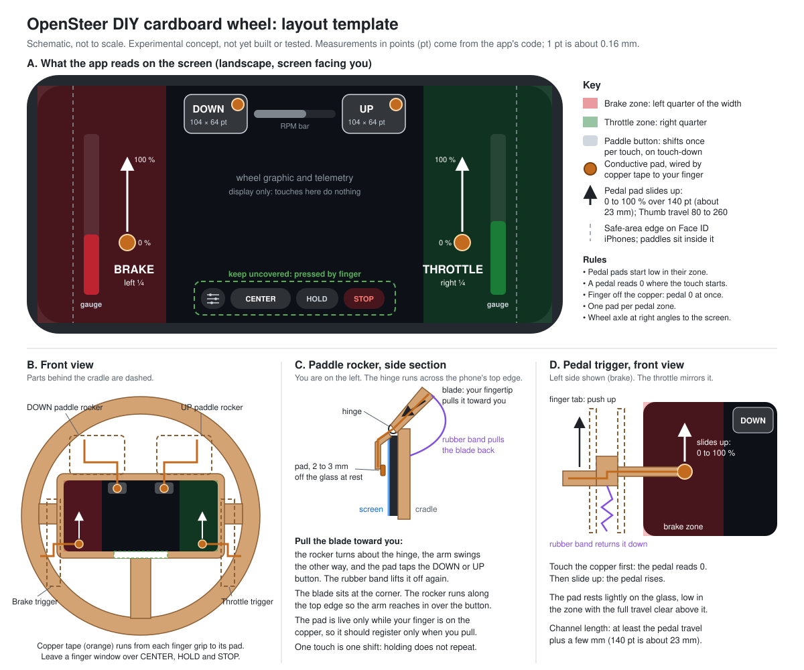

# DIY Cardboard Steering Wheel for an iPhone (OpenSteer)

[⬅️ Back to Main README](../../README.md)

> **Experimental DIY hardware concept.** Nobody has built or tested this rig yet,
> including me. It is a design open for community testing and contributions:
> STL files for 3D printing, laser-cut or cardboard templates, and build photos are
> all welcome. See [Contributing](#contributing).

This guide describes a fold-together cardboard steering wheel, in the spirit of
Nintendo Labo, that holds an iPhone running the OpenSteer app. Four cardboard levers
on the back work the app's on-screen controls for you: two paddle shifters and two
pedal triggers. They need no electronics, no batteries and no change to the app.
Strips of copper tape carry the touch of your fingers to the screen.

The template ([cardboard-wheel-template.svg](cardboard-wheel-template.svg)) is a
schematic, not a cutting pattern to scale. Step 1 of the build explains how to make
a positioning sheet that matches your own phone exactly.

## How the levers work the screen without electronics

An iPhone touchscreen is capacitive. It senses a conductor that is coupled to your
body, which is why a fingertip works and a pencil does not. Copper tape is a
conductor. If one end of a strip is under your finger and the other end ends in a
small conductive pad on the glass, the screen senses the pad as if it were your
fingertip at that spot.

So each lever has two jobs:

- **Close the circuit.** The finger grip on the back of the lever is covered with
  copper tape. The tape runs along the lever to a soft conductive pad. When your
  finger touches the grip, the pad becomes a "finger" on the screen. When your
  finger leaves the grip, the touch normally ends.
- **Move the pad.** The lever's motion moves the pad to the right place: onto a
  paddle button, or up the screen for a pedal.

Cardboard, paper and ordinary tape are insulators. On their own they can rest on
the glass without registering as a touch.

## What the app reads on the screen

The levers must match the app's landscape layout. These are the rules from the
code (`client-ios/App/OpenSteer/UI/ContentView.swift`, `PedalTouchView.swift` and
`client-ios/Sources/OpenSteerCore/PedalMapper.swift`):

| Screen area | Control | How it reads |
|---|---|---|
| Left quarter of the width | **Brake** | The pedal reads 0 where the touch starts and rises as the touch slides **up**. It reaches 100% after the "Thumb travel" distance, 140 points by default (80 to 260 in the app's settings) |
| Right quarter of the width | **Throttle** | Same as the brake |
| Top of the middle half, left end | **DOWN** paddle (downshift) | A 104 × 64 point button at the left end of the paddle row. The row is half the width of the safe area, centered, and its top is 14 points below the top of the safe area. The button sits 12 points in from the row's left end. It fires the moment it is touched |
| Top of the middle half, right end | **UP** paddle (upshift) | Same size, at the right end of the row. The RPM bar sits between the two paddles |
| Rest of the middle half | Wheel graphic, RPM bar, telemetry | Display only. Touches here do nothing |
| Middle half, bottom row | Settings, **CENTER**, **HOLD** (handbrake), **STOP** | Ordinary buttons |

One point is about 0.16 mm on the iPhones that can run the app (iOS 17 or later):
between about 0.154 and 0.166 mm, depending on the model, and more with Display Zoom
turned on. So the
default pedal travel is about 22 to 23 mm of slide, and each paddle button is about
16 to 17 × 10 mm.

What follows from those rules:

1. **Pedal pads stay in the outer quarters, paddle pads in the middle half.** Each
   pedal zone runs the full height of the screen, and the paddle buttons sit
   outside both zones. A paddle pad that lands in a pedal zone does not shift: it
   starts a pedal touch there and takes that zone's one tracked touch (rule 4). The
   gap between a paddle's outer edge and its pedal zone is 12 points plus half the
   side inset of the safe area: about 2 mm on an iPhone with a Home button, and
   about 6 to 7 mm on one with Face ID. Center each paddle pad on its button.
2. **The pedal starts at zero where the touch starts.** That point is wherever the
   pad is when your finger first touches the grip. Only the slide **up** from
   there counts. If the pad slides past full travel, the zero point follows it up,
   so the pedal stays at 100%.
3. **Letting go releases the pedal at once.** When your finger leaves the grip, the
   touch ends and the pedal drops to 0, wherever the pad is. The return spring only
   resets the lever for the next press.
4. **One pad per pedal zone.** Each zone tracks one touch. A contact that starts
   while the zone is already tracking a touch is ignored for as long as it stays
   down, even after the first one ends. Only a touch that starts after that is
   tracked.
5. **A paddle shifts once per touch.** Holding the pad down does not repeat the
   shift. The app holds the button on the wire for at least 3 packets, so even a
   very short tap counts.
6. **Leave the bottom row of the middle half uncovered.** You press **CENTER**,
   **HOLD** and **STOP** with a finger. A pad that drifts onto **STOP** ends the
   session.
7. **The wheel's axle must be at right angles to the screen.** Steering is the
   phone's twist about the screen normal. Any fixed tilt of the rig is fine, because
   tilt alone adds nothing. Press **CENTER** after the phone is mounted.

## Materials

- Corrugated cardboard, double-wall if you can get it, for the rim and the cradle.
- Conductive copper foil tape, about 6 mm wide. Check whether its adhesive is
  conductive: on many tapes it is not. Use one unbroken strip from grip to pad where
  you can. Where two strips must join, fold the copper face to face or solder it.
  Aluminum kitchen foil also works, but it tears.
- For the pads: black conductive foam (the kind electronic chips are shipped in), or
  the rubber tip of a cheap capacitive stylus. Make each pad about the size of a
  fingertip, roughly 7 to 10 mm across. Very small contacts may not register. Pink
  anti-static foam is usually not conductive enough.
- Rubber bands for the return springs.
- Clear tape to cover the copper where it runs along an arm. It only stops bare
  copper rubbing on the glass: the screen senses through thin tape as easily as
  through its own cover glass. What keeps the copper from registering is distance,
  so the arm itself must stay a few millimeters off the screen everywhere except at
  the pad.
- A craft knife, a ruler and glue.

## Build

### 1. Make a positioning sheet for your phone

Point measurements differ between iPhone models, so measure your own phone:

1. Start a session in the app so the driving screen shows.
2. Take a screenshot.
3. Measure the width of the lit screen in millimeters, with the phone in landscape.
4. Print the screenshot so that its width is exactly that measurement.

The print shows the paddle buttons, the bottom button row and the BRAKE and
THROTTLE gauges. Draw the pedal zones on it: the left and right quarters of the
width. Use this sheet to place every pad. The template SVG shows the same layout as a
schematic.

### 2. The cradle and the rim

1. Cut a window in a piece of cardboard the size of the phone. Glue a backing sheet
   behind it, so the phone sits in a shallow tray with the screen facing you.
2. Hold the phone in with tabs or rubber bands around the back. Keep everything off
   the screen, the side buttons and the charging port.
3. Cut a rim of any comfortable diameter and join it to the cradle with spokes at
   the left, the right and the bottom. Leave the top clear for the paddles.
4. Cut away the cradle's front frame over the middle of the bottom edge, so a finger
   can reach **CENTER**, **HOLD** and **STOP**.

### 3. The upper rear paddles (UpShift and DownShift)

Each paddle is a small rocker that sits on a hinge across the top edge of the phone.
Its blade sits near the top corner, and the rocker runs along the top edge so its arm
reaches in over the paddle button. The buttons are not in the top corners: they sit
at the top of the middle half, at the two ends of the paddle row, about a third of
the screen width in from each side.

1. Above the hinge, a cardboard blade stands up behind the rim, near the top corner,
   where your fingertip reaches it from behind the left or right spoke.
2. Below the hinge, a short arm hangs in front of the top of the screen. Its pad
   sits over the **DOWN** button (left) or the **UP** button (right), 2 to 3 mm off
   the glass. Use the positioning sheet to center it on the button.
3. A rubber band pulls the blade back, which holds the pad off the glass.
4. When you pull the blade toward you, the rocker turns about the hinge and the arm
   moves the other way, so the pad taps the button.
5. Run copper tape from the front face of the blade, where your fingertip pulls, over
   the hinge and down the arm to the pad. On the arm, keep the copper on the face
   away from the glass.

Because the pad should be live only while your finger is on the blade, the paddle
should register only when you pull it (see [Known risks](#known-risks-and-open-questions)).

### 4. The lower rear triggers (Throttle and Brake)

Each trigger is a slider in a vertical channel behind the left (Brake) or right
(Throttle) side of the phone.

1. Glue two cardboard rails behind the cradle, beside the phone's side edge, to make
   a vertical channel.
2. Make a slider that fits the channel. From it, an arm wraps around the phone's side
   edge and holds a pad lightly on the glass in the pedal zone. The pad rests near
   the lower part of the zone, with at least the full pedal travel of clear glass
   above it.
3. From the lower end of the slider, a finger tab sticks out behind the lower part of
   the rim, where your fingers curl. Your fingers push the tab up, and the tab pushes the slider up
   the channel.
4. Hook a rubber band from the bottom of the channel to the slider, so the slider
   returns downward when you let go.
5. Run copper tape from the finger tab, up the slider and along the arm, to the pad.
   On the arm, keep the copper on the face away from the glass, and stand the pad off
   the arm on its foam backing, so that only the pad comes near the screen.
6. Make the channel long enough for at least the full pedal travel, plus a few
   millimeters. The default 140 points is about 23 mm.

Squeezing the tab does two things in order. First your finger touches the copper,
so the touch starts and the pedal reads 0. Then the slider moves up, the pad
slides up the screen, and the pedal rises.

## Test it

1. Open the app and start a session. Watch the BRAKE and THROTTLE gauges at the
   screen edges: they fill from the bottom as a pedal applies.
2. Squeeze each trigger slowly. The gauge must start empty and fill smoothly. If it
   reaches full too early or too late, change **Thumb travel** in the app's settings
   (the settings button in the bottom row, or the connect screen).
3. Pull each paddle. The on-screen button lights while it is pressed. To check the
   PC side, start the daemon in its default mode (`--mode a`) and run
   `python tools/watch_controller.py`. It watches the virtual pad for 10 seconds
   from the moment it starts, then prints what it saw. Pull one paddle in that time:
   the `buttons` line at the end must not read `0x0000`. Run it once per paddle.
   Upshift is the pad's right bumper and downshift its left bumper.
4. Let go of everything. Both gauges must drop to empty, and no button may stay lit.

## Known risks and open questions

These are untested, and reports are welcome:

- **Phantom touches.** A pad resting on the glass with nobody touching the copper
  should not register, but some screens may sense a large floating conductor. If a
  pedal or paddle fires on its own, make the pad smaller or lift its rest position.
- **The arm registers instead of the pad.** Copper on an arm that runs close to the
  glass can start a touch before the pad does. In a pedal zone that touch then owns
  the zone, and the pad is ignored. Keep the arms off the glass.
- **Contact bounce.** A paddle shifts once per touch. If its pad bounces off the
  glass and lands again, that is a new touch, and it can reach the game as a second
  shift. A soft foam pad and a firm return spring should help.
- **Touch drop-outs while sliding.** If a pedal pad loses contact mid-slide, the
  touch ends, the pedal drops to 0, and the next contact starts a new zero point. A
  soft foam backing behind the pad keeps the contact steady.
- **Contact size.** iOS may ignore a contact much smaller or much larger than a
  fingertip. Start with a 7 to 10 mm pad.
- **Swipes from the bottom edge.** The app delays the system's swipe up from the
  bottom edge of the screen but cannot turn it off. A pedal pad that rests right on
  that edge and slides up may reach it, so rest the pad a little above the edge.
- **Grip.** The whole rig turns to steer, so the levers must stay in reach of your
  fingers through the full rotation. The default rotation setting is 90 degrees each
  way.

## Contributing

Open an issue or a pull request in
[DEZ-byte/SteeringControl](https://github.com/DEZ-byte/SteeringControl/issues) with:

- build photos and what worked or did not,
- cardboard cut sheets or laser-cut files (SVG or DXF), or 3D-printable STL parts, in
  `docs/hardware/`,
- the iPhone model, so others with the same screen size can reuse your measurements.
